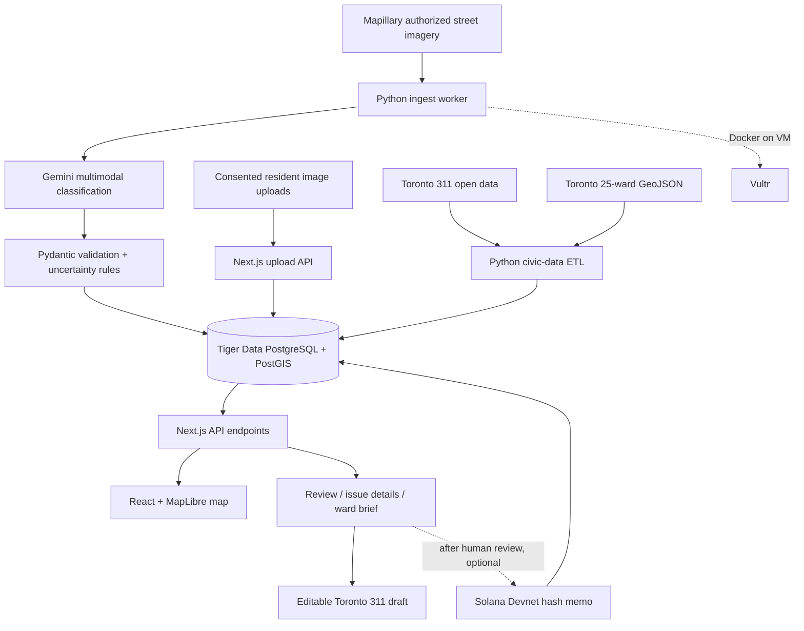
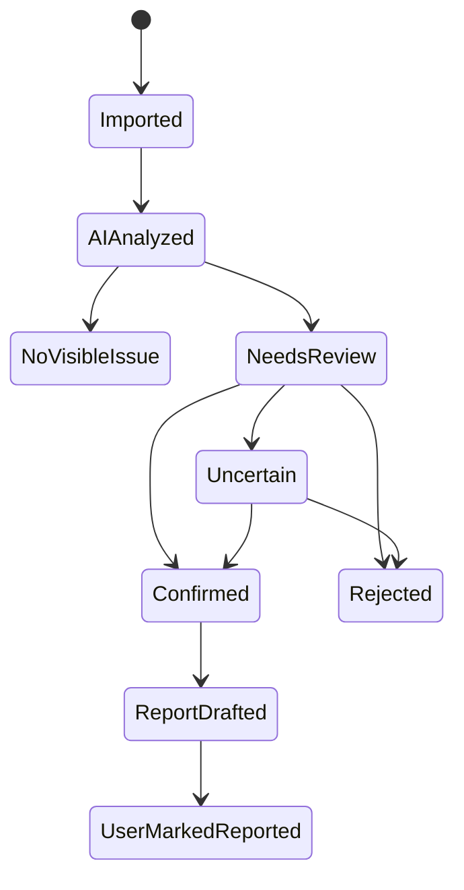

# GeoIssue — Complete Hackathon Implementation Blueprint

> **Hack the Valley 11 · School of Cities · Toronto 2026 civic-tech challenge**  
> **Version:** 1.0 · **Prepared:** 2026-10-16 · **Build window:** 36 hours · **Default team:** 3 developers  
> **Status:** Technical implementation plan, not an assertion that any services or integrations are already deployed.

**One-line pitch:** GeoIssue converts appropriately licensed, geotagged street imagery into *reviewable* infrastructure observations, locates them on a Toronto map, connects them to historical 311 context, and helps residents turn evidence into responsible action.

---

## 0. Read this first — implementation decisions

This document is intended to be sufficiently specific that three developers or coding agents can work from it immediately. Complete **Phase 0 → Phase 1 → Phase 2** before spending time on enhancements.

### Non-negotiable decisions

1. **Primary user:** Toronto resident or community advocate trying to understand and document local public-realm maintenance issues. **Secondary user:** municipal or community reviewer. The challenge emphasizes resident usefulness rather than building a private City back-office tool.
2. **MVP study area:** **one** Toronto area with actually available geotagged imagery (choose after testing access; do not hard-code a neighbourhood before confirming coverage). Display city-wide ward boundaries as geographic context.
3. **MVP issue classes:** `pothole`, `sidewalk_damage`, `illegal_dumping` and `none`. Other classes are future work.
4. **MVP image sources:** Mapillary under applicable access/licence terms **plus voluntary resident uploads**. No unauthorized Instagram/TikTok scraping, and never suggest these provide reliable public geotags.
5. **MVP pipeline:** source metadata → image bytes (licensed/authorized) → Gemini vision → schema validation → database → review queue → map. Images must not be reprocessed on each page view.
6. **Location semantics:** image coordinates refer to the **camera/observation point**; they do **not** establish the defect's exact location. Reviewer may correct a separate issue location.
7. **Reporting:** draft a clear, reviewable 311 request and link to the official Toronto 311 process; do not automatically send requests or claim the City received one.
8. **Civic comparison:** Toronto's public 311 data is **partial**, and available geography can be coarse. Compare **ward/month/category aggregates**, never claim that an individual defect is definitely “unreported.”
9. **Primary DB:** Tiger Data PostgreSQL with PostGIS and TimescaleDB, rather than a parallel Supabase database. This minimizes duplicated infrastructure and gives Tiger Data a genuine role.
10. **AI provider:** Google Gemini API as the first implementation. Keep one adapter interface so providers could be switched later, but do **not** integrate multiple vision providers in the first 36 hours.
11. **Deployment:** Next.js web/API on Vercel, image-ingestion Python worker on a Vultr VM, DB on Tiger Cloud. Local batch scripts must work without Vultr so deployment isn't a blocker.
12. **Sponsor stretch:** Solana proof-of-evidence *after a human confirms an observation*; no photographs, raw addresses, personal information, or false “blockchain verified” claims on-chain. GoDaddy and DEV are presentation/distribution add-ons.

### What success looks like by submission time

A judge opens a deployed URL, selects an area/ward, sees genuine analyzed street photographs on a working map, clicks a candidate issue, inspects the original image and AI explanation, observes its capture date and approximate location, sees related historical 311 statistics, verifies or rejects the issue via an authenticated reviewer view, and generates a 311-ready text draft. The same demo works with a persisted licensed fixture dataset if an upstream service is down.

### Definitions of done

- **P0 — functional MVP:** real source images + Gemini decisions + persistent DB + public map + issue detail + review + 311 context + report draft.
- **P1 — strong submission:** privacy/licensing/accessibility, exportable ward briefing, evaluation results, robust demo fallback.
- **P2 — prize extensions:** Vultr production worker, Tiger Data continuous aggregate demonstration, Solana audit hash, custom domain, DEV technical article.

---

## 1. Challenge alignment and product strategy

### What the School of Cities asks for

The attached *Hack the Valley x School of Cities* challenge describes a **usable civic product** helping people understand, navigate, or respond to a real Toronto urban problem surrounding the **2026 municipal election**. It asks for a defined user, concrete problem, Toronto data as a foundation, actionable benefits, and links to sources. It explicitly proposes 311 issue trends, maps, ward/neighbourhood tools, issue navigators and briefings. Judging dimensions include usefulness, creativity, urban insight, implementation, purposeful AI, accessibility and responsible interpretation.

The attached *Toronto Civic Data Starter Guide* recommends City of Toronto Open Data, **25 city ward boundaries**, OpenStreetMap, and **311 Service Requests — Customer Initiated**. It specifically warns that the public 311 dataset only covers part of the broader 311 system and that administrative geographies/categories change over time.

### User problem

A Toronto resident may see a damaged road or sidewalk but lack the time, knowledge, evidence, or confidence to file an effective report. Relevant photographs and Toronto civic records are fragmented. Someone trying to understand recurring local issues cannot easily distinguish a newly observed visual clue from a city-verified incident or an older 311 count.

### Product promise

- Discover *potential* public-realm problems in licensed street photographs.
- Make each observation traceable to an image, source, capture time and explicitly approximate location.
- Let humans confirm, reject or refine AI findings.
- Add meaningful ward-level historical 311 context rather than unsupported “unreported” classifications.
- Turn a reviewed issue into an accessible, editable 311 report draft.
- Keep analysis useful for residents **without candidate endorsements, election predictions or voting persuasion**.

### Personas and representative journeys

| Persona | Job to be done | Success |
|---|---|---|
| Resident (primary) | “What street-maintenance problems have been observed near me?” | Finds nearby evidence, knows if it is stale/uncertain, can prepare a report |
| Community group | “What problems should we discuss in our ward?” | Understands image coverage and 311 trends; exports a factual ward brief |
| Reviewer (secondary) | “Which AI suggestions are credible enough to act on?” | Confirms/rejects potential issues with provenance and audit trail |
| Journalist/researcher | “What can these data sources actually substantiate?” | Receives source links, time ranges, denominator caveats and a CSV export |

### Value proposition to judges

**Differentiator:** a traceable, **human-in-the-loop visual discovery** layer added to existing city reporting, not a replacement for Toronto 311. Gemini extracts evidence; Tiger Data analyzes time/ward activity; Toronto open data gives civic grounding. The design avoids declaring a problem current, severe, or unreported when the source doesn't support it.

---

## 2. Sponsor/MLH technology strategy

> The HTV11 Devpost currently lists the six MLH-related submission categories mentioned in the supplied prize page. Prize page banners can display historical quarter labels: **verify current event-specific eligibility, mandatory criteria and submission procedures with organizers**. Do not represent winning or eligibility as guaranteed.

| Technology / prize | Concrete GeoIssue application | Priority | Demonstration to judges |
|---|---|---|---|
| **Google Gemini API** | Multimodal detection from real street images; schema-constrained issue classification, bounding boxes when credible, plain-language explanations and ward brief copy grounded in SQL | **P0 core** | Click image → show Gemini structured output + source image |
| **Tiger Data** | Single managed PostgreSQL source of truth; PostGIS ward joins; TimescaleDB append-only event log and historical daily rollups | **P0 core / P1 analytics** | SQL tables + live ward chart + continuous aggregate query |
| **Vultr** | Host Dockerized scheduled batch ingestion and AI processing worker; structured logs and health checks | **P1 core deployment** | Trigger a worker run or show real logs and the results landing in DB |
| **Solana** | Optional audit anchoring: store SHA-256 digest of a canonical *reviewed evidence manifest* in a Devnet transaction memo; store transaction ID off-chain | **P2 only** | “Anchor evidence hash” after review; show explorer and hash verification |
| **GoDaddy Registry domain** | Descriptive project domain pointing to deployed site | **P2** | Working custom domain and concise memorable product identity |
| **DEV Writing Challenge** | Publish technical post on architecture, evaluation, open-data limits and lessons with live demo link | **P2** | Credible code-oriented project write-up after deployment |

**Why Solana is optional:** a blockchain transaction does **not** prove a photograph is genuine, that a pothole exists, or that an authority accepted the report. It only helps show a specific evidence manifest was committed at a particular point in the ledger's history. Ship the civic product first.

**Why use Tiger Data instead of Supabase here:** one DB is enough. Supabase remains a fallback only if Tiger Cloud setup fails or credit access is unavailable. Switching back means removing the Tiger sponsor integration claim unless Tiger Data remains materially used.

---

## 3. Scope, feature priorities and exclusions

### P0 acceptance matrix

| ID | Feature | Acceptance test |
|---|---|---|
| F01 | Image importer | Imports ≥30 authorized images or legitimate licensed fixtures with IDs, links, coordinates, capture dates and attribution |
| F02 | Gemini classifier | Processes selected images, validates structured responses, saves outcomes and failure states; no fake confidence percentages |
| F03 | Database persistence | Restart server, refresh browser; saved images/detections remain |
| F04 | Issue map | Display data on MapLibre; markers correspond to stored observed camera locations |
| F05 | Detail panel | Source/creator/license, photo capture date, issue evidence, classification, approximate map location and uncertainty |
| F06 | Review workflow | Authorized reviewer can confirm, reject, or mark uncertain; review creates audit event |
| F07 | Toronto civic overlay | Ward boundary, ward selector and time-filtered public 311 category counts |
| F08 | Report draft | Reviewed issue generates editable description; copy and open official 311 landing page; clear “not submitted” status |
| F09 | Degraded mode | Live API is disabled and licensed fixtures still load through the same DB/API/UI path |
| F10 | Production URL | Deployed responsive app with functioning public read-only view and protected review controls |

### P1 features

- Ward briefing panel: counts of AI candidates, reviewed confirmations and relevant published 311 requests; image-coverage denominator; distinct date ranges.
- Basic image bounding-box overlay **only when Gemini returns a valid box**; show a textual explanation otherwise.
- CSV export of non-sensitive issue metadata; shareable URL filters.
- Audit log for moderation; optimistic locking or a conflict-safe review update.
- Evaluation note with hand-labeled examples, precision estimate, failure cases and limitations.

### Explicit non-goals for a 36-hour hackathon

- Mass Instagram/TikTok scraping, private account access, bypassing protections, geolocation inference for individuals.
- Autonomous posting to 311 or bulk citizen complaints.
- Exact defect geolocation from a camera's GPS without verification.
- Claiming municipal priority/severity from one photograph or predicting repair completion.
- Citywide exhaustive coverage or statistically representative ward rankings.
- Public anonymous moderation or blockchain-first workflows.
- A native iOS/Android app, complex user profiles, multilingual generation and bespoke trained computer vision.

---

## 4. Architecture



### Runtime contracts

**Ingestion plane:** Python scripts invoked locally or from a Vultr Docker container. No public internet-facing worker API is required for P0. Image ingestion should run as a bounded batch (`--limit 100`, `--max-requests`, timeouts) and write to the DB. Do not store upstream API credentials in Next.js client bundles.

**Serving plane:** Next.js App Router server handlers query Tiger Data using parameterized `pg` queries. Public endpoints only return publishable metadata. Mutation endpoints require authentication and a reviewer allowlist. Browser requests never connect directly to Tiger DB.

**Analytics plane:** SQL view/queries provide issue counts, image coverage, verified detections, and ward-level 311 trends. TimescaleDB stores review/detection activity as an append-only log; a continuous aggregate summarizes historical activity for the Tiger demonstration. Today's most recent log events can be queried from raw events if an aggregate hasn't refreshed yet.

**Source-of-truth rule:** Images and model inferences are distinct entities. Never overwrite original capture date, original camera location, source link or model raw output when a person changes a reviewed issue location.

---

## 5. Recommended stack, dependencies, environments

| Responsibility | Choice | Implementation note |
|---|---|---|
| UI / API | Next.js App Router, TypeScript | Single web repository; Node.js runtime for DB routes |
| CSS / components | Tailwind CSS, shadcn/ui, Lucide | Fast accessibility-ready primitives; verify interaction with keyboard |
| Interactive map | MapLibre GL JS | Dynamic client-only map; OSM-compatible basemap with correct attribution |
| Charting | Recharts | Simple month-by-month counts and coverage charts |
| API schema | Zod | Validate query strings, request bodies and DB-to-UI DTOs |
| App database | Tiger Cloud PostgreSQL + PostGIS | Geospatial geometry; connection SSL and pooling |
| Event analytics | TimescaleDB extension | Issue activity hypertable and optional continuous aggregate |
| SQL driver | `pg` (node-postgres), `psycopg` (Python) | Use placeholders, never string interpolation of SQL values |
| Authentication | Auth.js GitHub OAuth, JWT sessions | Restrict privileged user IDs using `ADMIN_GITHUB_IDS` |
| AI / images | Gemini API (`google-genai`) | Python Pydantic structured output; server-side only |
| ETL | Python 3.11+, `httpx`, `pydantic`, `psycopg`, `Pillow`, `tenacity` | Independent CLI commands; max-size and timeout guards |
| Worker hosting | Vultr VM + Docker Compose | Run on-demand before scheduling; no inbound port required |
| Web hosting | Vercel | Environment variables, domain config and preview deployments |
| User uploads | Optional image object storage | Only if upload feature is implemented; enforce consent and moderation |
| Tests | Vitest, Playwright, pytest | Unit, API, DB integration, browser smoke tests |
| Collaboration | GitHub repo, issues/PRs | CODEOWNERS optional; protect `main` during critical integration |

**Avoid premature dependency sprawl.** If auth or uploads are not ready, keep anonymous read-only map working and restrict write endpoints to a single known review account before demo. Never deploy unauthenticated `PATCH` endpoints.

### Setup commands (reference; adapt paths)

```bash
mkdir geoissue && cd geoissue
git init
npx create-next-app@latest web --ts --tailwind --eslint --app --src-dir --import-alias '@/*'
cd web
npm install maplibre-gl pg zod recharts next-auth lucide-react
npm install -D @types/pg vitest @testing-library/react @testing-library/jest-dom
cd ..
mkdir -p worker/scripts worker/tests db/migrations data/fixtures docs
python3 -m venv .venv
source .venv/bin/activate
python -m pip install --upgrade pip
pip install google-genai pydantic httpx 'psycopg[binary]' python-dotenv Pillow tenacity pytest
```

`shadcn/ui` can be initialized inside `web` after layout boots. Use `npx playwright install` only after adding Playwright test tooling.


### First 60 minutes: copy-paste integration smoke test

Run these from the repository root once the environment files are populated and the real service accounts are configured. The import commands refer to scripts that the team must implement in the stated tickets; the migration and web startup commands can run as soon as scaffolding and DB credentials exist.

```bash
# 1. Initialize DB schema on an empty Tiger Cloud database.
psql "$DATABASE_URL" -v ON_ERROR_STOP=1 -f db/migrations/001_init.sql

# 2. Have Developer C implement ward import before running:
python worker/scripts/import_wards.py --input data/toronto_wards.geojson

# 3. Start the public app locally in a second terminal:
cd web && npm run dev

# 4. Confirm service readiness and the empty-state API contract:
curl -i http://localhost:3000/api/health
curl -i 'http://localhost:3000/api/issues?west=-79.5&south=43.6&east=-79.2&north=43.8'

# 5. After Developer A implements importer and Gemini adapter:
python worker/scripts/classify_pending.py --limit 10 --concurrency 2
```

**Pass gate:** healthy DB route, no fatal browser errors, real ward polygons import, at least one real or plainly labeled fixture issue pin, and valid attribution. If any service is not yet provisioned, don't invent credentials or dummy municipal results.

### Environment variables

`web/.env.local` **(never commit):**

```dotenv
DATABASE_URL=postgresql://<USER>:<PASSWORD>@<TIGER_HOST>:<PORT>/<DB>?sslmode=require
AUTH_SECRET=<RANDOM_LONG_SECRET>
AUTH_GITHUB_ID=<GITHUB_OAUTH_APP_ID>
AUTH_GITHUB_SECRET=<GITHUB_OAUTH_APP_SECRET>
ADMIN_GITHUB_IDS=<COMMA_SEPARATED_NUMERIC_GITHUB_USER_IDS>
NEXT_PUBLIC_APP_URL=http://localhost:3000
NEXT_PUBLIC_MAP_STYLE_URL=<ATTRIBUTED_MAP_STYLE_URL>
NEXT_PUBLIC_DEMO_MODE=false
```

`worker/.env` **(never commit):**

```dotenv
DATABASE_URL=postgresql://<USER>:<PASSWORD>@<TIGER_HOST>:<PORT>/<DB>?sslmode=require
MAPILLARY_ACCESS_TOKEN=<TOKEN>
GEMINI_API_KEY=<KEY>
GEMINI_MODEL=<MODEL_CONFIRMED_AVAILABLE_TO_ACCOUNT>
IMAGE_LIMIT=100
MAX_IMAGE_BYTES=8000000
SOURCE_MODE=mapillary
```

Optional Solana server-only configuration:

```dotenv
SOLANA_RPC_URL=https://api.devnet.solana.com
SOLANA_CLUSTER=devnet
SOLANA_SIGNER_SECRET=<DEVNET_ONLY_SIGNING_KEY_STORED_SECURELY>
```

Never copy an `.env` file into Docker images, commit API keys, ship a privileged database credential into client code, or expose signer secrets in the browser.

---

## 6. Data model and database migrations

### Entity overview

- `wards`: official ward boundaries and names.
- `street_images`: one row per authorized photo, preserving provenance and **camera** coordinate.
- `detections`: one potential AI-identified issue per row, linked to an image; independent human review status/location.
- `ward_311_monthly`: aggregated public 311 history, with disclosed scope and filters.
- `issue_events`: immutable audit/analytics event log and real Tiger Data hypertable.
- `ingestion_runs`: monitoring/error state for CLI jobs.
- `evidence_anchors` (optional): off-chain mapping from approved issue → Solana hash transaction.

### `db/migrations/001_init.sql`

```sql
CREATE EXTENSION IF NOT EXISTS postgis;
CREATE EXTENSION IF NOT EXISTS timescaledb;

CREATE TABLE IF NOT EXISTS wards (
  ward_number INTEGER PRIMARY KEY,
  ward_name TEXT NOT NULL,
  geom geometry(MultiPolygon, 4326) NOT NULL
);
CREATE INDEX IF NOT EXISTS wards_geom_idx ON wards USING GIST (geom);

CREATE TABLE IF NOT EXISTS street_images (
  id UUID PRIMARY KEY DEFAULT gen_random_uuid(),
  source TEXT NOT NULL CHECK (source IN ('mapillary', 'resident', 'fixture')),
  source_image_id TEXT NOT NULL,
  source_url TEXT NOT NULL,
  display_image_url TEXT,
  creator_name TEXT,
  attribution_text TEXT NOT NULL,
  licence_name TEXT NOT NULL,
  captured_at TIMESTAMPTZ,
  imported_at TIMESTAMPTZ NOT NULL DEFAULT NOW(),
  camera_geom geometry(Point, 4326) NOT NULL,
  camera_location_accuracy_m INTEGER,
  ward_number INTEGER REFERENCES wards(ward_number),
  image_sha256 CHAR(64),
  data_mode TEXT NOT NULL DEFAULT 'live'
    CHECK (data_mode IN ('live', 'fixture')),
  UNIQUE(source, source_image_id)
);
CREATE INDEX IF NOT EXISTS street_images_camera_idx
  ON street_images USING GIST (camera_geom);
CREATE INDEX IF NOT EXISTS street_images_ward_idx
  ON street_images (ward_number, captured_at DESC);

CREATE TABLE IF NOT EXISTS detections (
  id UUID PRIMARY KEY DEFAULT gen_random_uuid(),
  image_id UUID NOT NULL REFERENCES street_images(id) ON DELETE CASCADE,
  issue_type TEXT NOT NULL
    CHECK (issue_type IN ('pothole', 'sidewalk_damage', 'illegal_dumping')),
  severity_hint TEXT NOT NULL DEFAULT 'unknown'
    CHECK (severity_hint IN ('low', 'medium', 'high', 'unknown')),
  evidence_text TEXT NOT NULL,
  visual_certainty TEXT NOT NULL
    CHECK (visual_certainty IN ('low', 'medium', 'high')),
  bbox_yxyx JSONB,
  model_name TEXT NOT NULL,
  model_output JSONB NOT NULL,
  detected_at TIMESTAMPTZ NOT NULL DEFAULT NOW(),
  review_status TEXT NOT NULL DEFAULT 'needs_review'
    CHECK (review_status IN ('needs_review', 'confirmed', 'rejected', 'uncertain')),
  reviewer_github_id TEXT,
  reviewer_note TEXT,
  reviewed_at TIMESTAMPTZ,
  reviewed_issue_geom geometry(Point, 4326),
  report_status TEXT NOT NULL DEFAULT 'not_started'
    CHECK (report_status IN ('not_started', 'drafted', 'user_reported')),
  duplicate_of UUID REFERENCES detections(id),
  UNIQUE(image_id, issue_type)
);
CREATE INDEX IF NOT EXISTS detections_review_idx
  ON detections(review_status, issue_type, detected_at DESC);
CREATE INDEX IF NOT EXISTS detections_reviewed_geom_idx
  ON detections USING GIST(reviewed_issue_geom);

CREATE TABLE IF NOT EXISTS ward_311_monthly (
  ward_number INTEGER NOT NULL REFERENCES wards(ward_number),
  month DATE NOT NULL,
  category TEXT NOT NULL,
  request_count INTEGER NOT NULL CHECK(request_count >= 0),
  data_version TEXT NOT NULL,
  PRIMARY KEY(ward_number, month, category, data_version)
);
CREATE INDEX IF NOT EXISTS ward311_month_idx
  ON ward_311_monthly(month DESC, category);

CREATE TABLE IF NOT EXISTS ingestion_runs (
  id UUID PRIMARY KEY DEFAULT gen_random_uuid(),
  job_name TEXT NOT NULL,
  started_at TIMESTAMPTZ NOT NULL DEFAULT NOW(),
  finished_at TIMESTAMPTZ,
  status TEXT NOT NULL DEFAULT 'running',
  imported_count INTEGER NOT NULL DEFAULT 0,
  analyzed_count INTEGER NOT NULL DEFAULT 0,
  error_count INTEGER NOT NULL DEFAULT 0,
  error_message TEXT
);

-- Append-only hypertable; composite key includes the time partition column.
CREATE TABLE IF NOT EXISTS issue_events (
  occurred_at TIMESTAMPTZ NOT NULL DEFAULT NOW(),
  event_id UUID NOT NULL DEFAULT gen_random_uuid(),
  detection_id UUID,
  ward_number INTEGER,
  issue_type TEXT,
  event_action TEXT NOT NULL CHECK (
    event_action IN ('detected', 'confirmed', 'rejected', 'uncertain', 'drafted')
  ),
  actor_type TEXT NOT NULL CHECK (actor_type IN ('system', 'reviewer')),
  PRIMARY KEY(occurred_at, event_id)
);
SELECT create_hypertable('issue_events', by_range('occurred_at'),
  if_not_exists => TRUE);
CREATE INDEX IF NOT EXISTS issue_events_ward_idx
  ON issue_events(ward_number, occurred_at DESC);

-- Optional phase 2 blockchain metadata. No PII or photo on chain.
CREATE TABLE IF NOT EXISTS evidence_anchors (
  id UUID PRIMARY KEY DEFAULT gen_random_uuid(),
  detection_id UUID NOT NULL UNIQUE REFERENCES detections(id),
  manifest_sha256 CHAR(64) NOT NULL,
  solana_cluster TEXT NOT NULL DEFAULT 'devnet',
  transaction_signature TEXT UNIQUE,
  anchored_at TIMESTAMPTZ,
  state TEXT NOT NULL DEFAULT 'pending'
    CHECK (state IN ('pending','confirmed','failed'))
);
```

**Why no single numeric “AI confidence”:** multimodal model-generated percentages are typically not calibrated probabilities. Store ordinal `visual_certainty`, show the evidence text and record a hand-reviewed precision estimate separately.

**Why separate locations:** `camera_geom` never changes; `reviewed_issue_geom` is nullable and populated only when a person can confidently place a defect. Public marker defaults to camera location and says **“approximate observation point.”**

**Data-mode transparency:** demo fixtures are labeled `fixture` and `source='fixture'` even when based on real, attributed photos. Never pass fabricated records off as live discoveries.

### PostGIS spatial assignment for a new image

```sql
UPDATE street_images si
SET ward_number = w.ward_number
FROM wards w
WHERE si.id = $1
  AND ST_Covers(w.geom, si.camera_geom);
```

Where image lies on a ward border, check results and display a geographic ambiguity notice; don't silently force a nearest ward. When ward boundaries are not available, disable ward analysis gracefully.

### Tiger Data continuous aggregate (Phase 1)

```sql
CREATE MATERIALIZED VIEW IF NOT EXISTS ward_daily_issue_events
WITH (timescaledb.continuous) AS
SELECT
  time_bucket('1 day', occurred_at) AS day,
  ward_number,
  issue_type,
  event_action,
  COUNT(*)::BIGINT AS event_count
FROM issue_events
GROUP BY 1, 2, 3, 4
WITH NO DATA;

SELECT add_continuous_aggregate_policy(
  'ward_daily_issue_events',
  start_offset => INTERVAL '90 days',
  end_offset => INTERVAL '1 day',
  schedule_interval => INTERVAL '1 hour'
);
```

For the very latest/incomplete day, fetch live counts from `issue_events`; don't expect a historical continuous-aggregate policy to include today's partial bucket. Confirm current Tiger Cloud feature availability before running optional DDL.

### Query: issues in visible bounds (conceptual, parameterized)

```sql
SELECT
  d.id, d.issue_type, d.review_status, d.visual_certainty,
  d.evidence_text, d.detected_at, d.severity_hint,
  si.captured_at, si.source_url, si.display_image_url,
  si.attribution_text, si.licence_name, si.ward_number,
  ST_Y(COALESCE(d.reviewed_issue_geom, si.camera_geom)) AS lat,
  ST_X(COALESCE(d.reviewed_issue_geom, si.camera_geom)) AS lng,
  (d.reviewed_issue_geom IS NOT NULL) AS issue_location_reviewed
FROM detections d
JOIN street_images si ON si.id = d.image_id
WHERE si.camera_geom && ST_MakeEnvelope($1, $2, $3, $4, 4326)
  AND ($5::TEXT IS NULL OR d.issue_type = $5)
  AND ($6::TEXT IS NULL OR d.review_status = $6)
ORDER BY d.detected_at DESC
LIMIT 250;
```

**Important:** this bounding-box query filters by *camera* geometry. For large-scale production views, decide explicitly whether the map should query camera locations, reviewed issue locations, or both. Use a server-side API input validator to ensure longitude/latitude bounds are valid and within a conservative Toronto search area.

---

## 7. Real data acquisition: Mapillary and Toronto

### Mapillary API (main image supply)

Official reference: https://github.com/mapillary/api-demo and https://www.mapillary.com/ . Mapillary's Graph API exposes image metadata, geometry, capture time and thumbnail references. Official API demo shows image metadata and detections endpoints. Mapillary imagery is CC BY-SA; attribution and actual permitted API use must be respected.

**Source contract:**

```ts
type StreetImageSource = {
  source: 'mapillary' | 'resident' | 'fixture';
  sourceImageId: string;
  sourceUrl: string;            // link to underlying image/source page
  displayImageUrl: string | null; // may be ephemeral; fetch/refresh when necessary
  creatorName: string | null;
  attributionText: string;
  licenceName: string;
  capturedAt: string | null;   // ISO timestamp
  cameraLat: number;
  cameraLng: number;
  cameraLocationAccuracyM: number | null;
};
```

**Start with a one-image smoke test**, then a bounded page of results. A Mapillary listing request may resemble:

```http
GET https://graph.mapillary.com/images?bbox={west},{south},{east},{north}&fields=id,geometry,captured_at,thumb_1024_url,creator&limit=100
Authorization: OAuth <MAPILLARY_ACCESS_TOKEN>
```

Check actual token type, access permissions, supported parameters, page cursors and response shape against current docs before assuming this example works. Use configured API authentication from your account, not browser-exposed secrets. Handle pagination; do not hammer the API.

**Acceptance/stop condition:** The first working page produces ≥10 images with a retrievable original source link, a camera coordinate, and an appropriate credit. If this isn't working within two hours, switch to the authorized fixture path; do not let the team stall.

**Ingestion steps:**

1. Select bbox inside Toronto from actual data availability (no invented source photos).
2. Request ≤100 image records; deduplicate by `(source, source_image_id)`.
3. Validate coordinate ranges and source fields; skip malformed metadata.
4. Retrieve permitted image bytes for AI via a controlled source adapter and bounded HTTP download.
5. For upload or remote fetch: accept only JPEG/PNG/WEBP, respect size limit, deny redirects to private IPs, time out, and reject unsupported content.
6. Strip/avoid PII; preserve attribution, capture timestamp, thumbnail/source permalink.
7. Assign ward via PostGIS; call Gemini only on eligible images.
8. Upsert results, create a detection event for new positive classifications and log failures.
9. Preserve idempotency: rerunning import must not duplicate image records or generated classifications.
10. Record a run ID, counts, duration and any errors in `ingestion_runs`.

**Sample command contract:**

```bash
python worker/scripts/import_mapillary.py \
  --bbox <WEST,SOUTH,EAST,NORTH> \
  --limit 100 \
  --dry-run

python worker/scripts/import_mapillary.py \
  --bbox <WEST,SOUTH,EAST,NORTH> --limit 100

python worker/scripts/classify_pending.py --limit 50 --concurrency 2
```

Those commands are **target CLI interfaces to implement**, not commands that exist before you write the scripts.

### Resident-contributed images (phase 1 only if feasible)

User enters a location, explicitly confirms that they have rights/consent to share the image, chooses the relevant street location, and uploads JPEG/PNG/WEBP under size and abuse limits. Server strips private EXIF, obscures sensitive elements if required, stores the photo in controlled object storage, and creates `street_images.source='resident'`. An upload is **not** considered verified. Do not publish automatically; enter review queue.

Never use a user's private EXIF home/work GPS as a public coordinate without clear, affirmative confirmation.

### Toronto 311 data

Start at: https://open.toronto.ca/dataset/311-service-requests-customer-initiated/ . Import a bounded date range from the available official resource files. Dataset field names, package IDs and category vocabulary must be inspected before coding mappings.

**ETL recipe:**

1. Download official 311 resource using its current portal/API file URL and log the exact source/download date.
2. Inspect actual columns; make a **field mapping configuration** (`date`, `category`, `ward`, `status`, optional location). Do not hard-code guessed field names.
3. Normalize time to calendar month, keep timezone semantics, and map only documented relevant issue categories (e.g., road repair, sidewalk damage, dumping) after reviewing labels.
4. If official ward data is present, use it. If only approximate intersection/FSA data are present, **do not geocode to a precise incident point**; omit impossible ward assignment rather than inventing one.
5. Aggregate by `{ward_number, month, category}` with immutable `data_version` and provenance metadata in a `docs/data-lineage.md` file.
6. Exclude cancelled/duplicate records only if documented and state the filters; don't interpret “closed” as “fixed” by default.
7. Import via SQL `INSERT ... ON CONFLICT ... DO UPDATE` and show known null/coverage rates.
8. Compare historical 311 activity and image-derived candidate issues side by side, *not* as a direct numerator/denominator “government response rate.”

**Data dictionary in the product:** “Public 311 request counts reflect a published subset of requests, not every City service interaction. Available location or category detail may be coarse. The image observations are also a non-random sample and do not measure all physical damage in a ward.”

### Toronto ward boundaries

Find an official 25-ward boundary GeoJSON in Toronto Open Data. Save its official dataset name, resource URL, version/date and licence. Import each polygon with `ST_SetSRID(ST_GeomFromGeoJSON(...), 4326)`; convert single polygons to multipolygons with `ST_Multi` if required; call `ST_Transform` if source CRS isn't WGS84. Validate ward count **25** and spatial extent around Toronto before using.

### Fixture strategy (required)

Maintain `data/fixtures/manifest.json` plus authorized fixture imagery or stable source references. Minimum 12–20 items: positive pothole, positive sidewalk, dumping, clean negatives, ambiguous and old photos. Source, creator/licence, capture date and camera coordinate must remain genuine or be conspicuously marked `synthetic`. A *synthetic* source/location must never appear as a real detected Toronto pothole. Fixtures must go through the same importer/API/UI and show a **Demo Fixture** label.

---

## 8. Gemini vision pipeline

Use Google GenAI SDK from a **server-side Python worker**. Official docs: https://ai.google.dev/gemini-api/docs/image-understanding and https://ai.google.dev/gemini-api/docs/structured-output . Confirm `GEMINI_MODEL` availability against your account. Prefer a fast multimodal model for the hackathon; pin a tested model ID before final demo.

### The detector's actual task

Output only things that are **visually supported by the image**. Say no issue when unclear. Classify the image, not its neighbourhood, creator or people. Never infer precise geographic coordinates, repair status, age of defect, municipal responsibility or a validated safety rating from a photograph.

### `worker/detector_schema.py` (reference contract)

```python
from typing import Literal
from pydantic import BaseModel, Field, model_validator

IssueType = Literal["pothole", "sidewalk_damage", "illegal_dumping"]
Certainty = Literal["low", "medium", "high"]
Severity = Literal["unknown", "low", "medium", "high"]

class Candidate(BaseModel):
    issue_type: IssueType
    visual_certainty: Certainty
    severity_hint: Severity = "unknown"
    evidence_text: str = Field(min_length=8, max_length=360)
    box_2d: list[int] | None = Field(
        default=None,
        description="[ymin,xmin,ymax,xmax], integers 0..1000, only if visually clear"
    )

    @model_validator(mode="after")
    def valid_box(self):
        if self.box_2d is not None:
            b = self.box_2d
            if len(b) != 4 or any(not (0 <= n <= 1000) for n in b):
                raise ValueError("invalid 2D box")
            if not (b[0] < b[2] and b[1] < b[3]):
                raise ValueError("box coordinates out of order")
        return self

class ImageAssessment(BaseModel):
    is_street_scene: bool
    candidates: list[Candidate] = Field(default_factory=list, max_length=3)
    uncertainty_note: str = Field(max_length=300)
```

### Prompt (save as `worker/prompts/detect_issues.txt`)

```text
You are a conservative visual infrastructure assessor for a civic-tech demo.
Analyze ONLY what is visible in the supplied street photograph.
Return structured data matching the supplied schema.

Eligible categories:
- pothole: clear visible hole/depression in paved roadway; do not confuse
  with shadows, puddles, drain covers, road patches, leaves or perspective.
- sidewalk_damage: visibly broken, displaced or cracked pedestrian pavement;
  do not mistake painted markings for damage.
- illegal_dumping: plainly discarded bulk waste/garbage in a public space;
  do not infer dumping from ordinary trash bins or legitimate collections.

Rules:
1. Return an empty candidates array if the evidence is insufficient.
2. Do not infer that a problem still exists today from a historical image.
3. Do not guess GPS coordinates, exact street address, legal responsibility,
   injury risk, cause or municipal repair status.
4. Explain each candidate using only verifiable visible details, at most
   one sentence each. Use 'unknown' severity when ambiguous.
5. If bounding area is clear, give box_2d as [ymin,xmin,ymax,xmax]
   normalized to 0..1000; otherwise null.
6. Give no more than three candidates and never invent an object.
7. Output must match the declared JSON schema, with no extra commentary.
```

### Gemini adapter skeleton (`worker/gemini_detector.py`)

```python
import os
from google import genai
from google.genai import types
from detector_schema import ImageAssessment

client = genai.Client(api_key=os.environ["GEMINI_API_KEY"])
MODEL = os.environ["GEMINI_MODEL"]

def analyze_image(image_bytes: bytes, mime_type: str, prompt: str) -> ImageAssessment:
    result = client.models.generate_content(
        model=MODEL,
        contents=[
            prompt,
            types.Part.from_bytes(data=image_bytes, mime_type=mime_type),
        ],
        config=types.GenerateContentConfig(
            response_mime_type="application/json",
            response_schema=ImageAssessment,
            temperature=0,
        ),
    )
    if not result.text:
        raise ValueError("Gemini returned no JSON text")
    return ImageAssessment.model_validate_json(result.text)
```

**Adapter caveat:** Check the SDK signature against the installed version during development; use a pinned `google-genai` dependency after smoke testing. Structured output is schema-constrained but not proof of accuracy. Model errors, content filters, rate limits and invalid responses must be caught and recorded, never silently converted into “no issue.”

### Worker decision logic

1. Verify image MIME/size, orientation and source permission.
2. Skip already processed image ID/model-version combination; if reprocessing, store a new revision or clearly replace only unreviewed inference (do not overwrite human reviews).
3. Load prompt from versioned file; make bounded Gemini call with retries (exponential backoff on transient errors only).
4. Validate Pydantic schema and box ordering; reject invalid.
5. Drop `visual_certainty='low'` candidates from default public results but preserve them for reviewer inspection. Keep medium/high in the review queue.
6. Create at most three `detections` for one photo, one per issue class.
7. Save raw model JSON, model ID, detected timestamp, explanation and review status.
8. Emit `issue_events` action `detected` for each new candidate.
9. Do not hide fresh/unreviewed vs confirmed status.
10. Retain an evaluation CSV with human `true_positive`, `false_positive`, `uncertain` annotations and image source ID.

### Quantitative evaluation

Hand-label at least **20–30 real images** including negatives; don't cherry-pick only positive examples. Report `precision = confirmed_model_positives / all_reviewed_model_positives` with sample size and selection caveats; optionally recall if the sample has an exhaustive independently annotated set. Also report ambiguous cases, false positives (shadows/patches/bins) and how many observations were old. Do not claim citywide model accuracy from this small biased set.

---

## 9. Ingestion, deduplication and trust states

### A simple explicit state machine



Store image-level processing state in worker logs/`ingestion_runs`; detection rows exist only for detected candidate types. Lack of a detection must not be conflated with an API failure; build an `image_analyses` or `image_processing_status` table if you need row-by-row “no issue vs error” audit at scale. For MVP, `ingestion_runs` plus structured worker JSONL logs suffice, but add a `processing_state`/`last_error` column to `street_images` if the admin queue needs it.

### Duplicate management

**P0:** deduplicate *images* by source ID, and *classifications* by `(image_id, issue_type)`. This is deterministic and easy to test.

**P1:** suggest duplicate *issues* when reviewed locations are within 20–30 metres, categories agree, and capture dates are reasonably close; **do not auto-merge**. Store `duplicate_of`, show related photos, and require human approval because two potholes can be near each other and camera points may be misleading.

### Staleness rule

Use capture age to display `captured X months ago`. Flag images over 12 months as **possibly outdated** and require a newer confirmation for any claim about current infrastructure condition. A newer image of the same street can contradict the candidate; show both rather than silently declaring repaired.

---

## 10. Public UI and visual behavior

### Main navigation

- `/` — GeoIssue overview + Explore Toronto map (default).
- `/issues/[id]` — deep-linkable issue evidence page.
- `/wards/[wardNumber]` — ward-level 311 context and observation coverage briefing.
- `/review` — authenticated candidate queue and moderation actions.
- `/about` — methodology, sources, licences, caveats, accessibility.

### Desktop layout

```text
+--------------------------------------------------------------------+
| GeoIssue       Explore | Ward insights | Methodology    Sign in    |
+----------------------+---------------------------------------------+
| Filters              | MAPLIBRE MAP                                |
| - Ward               |   circles: potential / confirmed / rejected|
| - Issue class        |   toggle: ward boundaries                   |
| - Review status      |   markers denote camera/observed points    |
| - Capture date       |                                             |
| - Demo/live source   |                                             |
+----------------------+----------------------------+----------------+
| KPI strip: photos analyzed | candidates | confirmed | coverage     |
+------------------------------------------+-------------------------+
| Selected issue: image + rights + capture | 311 context chart       |
| date + AI evidence + review history      | by month/ward/category  |
| [Review] [Prepare 311 draft]             | data limitations        |
+------------------------------------------+-------------------------+
```

### Marker semantics

- **Amber:** unverified AI candidate.
- **Green:** reviewer confirmed.
- **Grey:** uncertain/stale.
- **Rejected:** hidden by default but visible in reviewer view or under a transparency toggle.
- Avoid a pure red/green-only legend; include icons/shapes and accessible text.
- Image icon/data label should say **“Approximate photo observation point”** until a reviewer adjusts a specific issue location.

### Issue details must always show

1. Evidence photograph with link to original source and contributor/CC BY-SA attribution when applicable.
2. Exact capture date when known, or **“Capture date unknown”**.
3. AI category, explanation and *ordinal* certainty; “AI suggestion, not a verified municipal finding.”
4. Original camera coordinates displayed as approximate; if reviewer location exists, show it separately and identify as human-adjusted.
5. Review state and review timestamp; no personally identifying reviewer details beyond a generic role in public UI.
6. Related ward's 311 trend and data source/date range, explicitly **not** a one-to-one matching report.
7. “Prepare report” action only for `confirmed` by default; user may still submit a report directly via Toronto 311 outside the app.
8. Licence/attribution; never show an image without a usable source/permission basis.

### Mobile behavior

Map occupies most of screen; filters open as bottom sheet; issue details open as a drawer. Buttons min ~44×44px, reachable from keyboard, semantic headings, sufficient contrast, no map-only essential info. Offer a text list of visible issues for users who cannot operate the map.

### Ward briefing copy (Gemini optional)

Use SQL-derived numbers as the ONLY factual inputs, send a small structured JSON to Gemini, and ask for a 100–150 word **neutral explanatory paragraph**. Include the record date range, number of image observations, number of confirmed issues, categories and historical 311 counts. System prompt explicitly prohibits inventing rates, filling missing data, political recommendations, candidate endorsements, or saying “neglected ward.” Keep the raw facts visible regardless of AI-generated prose. Cache results with a data-version key.

---

## 11. REST API specification

All endpoints are Next.js Route Handlers and use Node.js runtime (not Edge for raw `pg` unless separately verified). Each mutating request uses Zod validation, authentication/authorization and database transactions. For security, add rate limiting and small maximum response sizes.

| Method | Endpoint | Visibility | Purpose |
|---|---|---|---|
| `GET` | `/api/health` | public | Database/readiness status without secrets |
| `GET` | `/api/issues` | public | Bounding-box issue list with filters and page limit |
| `GET` | `/api/issues/:id` | public | Evidence, source metadata, review status, suitable related context |
| `GET` | `/api/wards` | public | Ward boundaries/metadata or simplified GeoJSON |
| `GET` | `/api/wards/:number/summary` | public | Observations + 311 monthly counts with provenance |
| `PATCH` | `/api/issues/:id/review` | reviewer | Set `confirmed`, `rejected`, `uncertain`; optional note/location |
| `POST` | `/api/reports/draft` | reviewer / eligible user | Return sanitized editable 311 description, no external submission |
| `GET` | `/api/review/queue` | reviewer | Candidate queue and error/stale flags |
| `GET` | `/api/exports/ward/:number.csv` | public | Sanitized civic data export (P1) |
| `POST` | `/api/anchors` | reviewer | Optional Devnet proof anchor (P2) |

### `GET /api/issues`

Parameters: `west`, `south`, `east`, `north` (bbox), `type`, `status`, `ward`, `captured_after`, `limit<=250`, `cursor` optional. Validate WGS84 coordinate ranges, minimum/maximum bbox, and date format. Server-side default filters to `needs_review`, `confirmed`, `uncertain` and excludes `rejected` from public results.

**200 response example:**

```json
{
  "issues": [
    {
      "id": "00000000-0000-0000-0000-000000000001",
      "issueType": "pothole",
      "reviewStatus": "needs_review",
      "visualCertainty": "medium",
      "observedPoint": { "lat": 43.65, "lng": -79.38 },
      "pointKind": "camera_approximate",
      "capturedAt": "2026-06-03T13:15:00Z",
      "wardNumber": 10,
      "source": "fixture"
    }
  ],
  "nextCursor": null,
  "dataNotice": "Issue pins may indicate camera positions, not exact defect locations."
}
```

**Note:** coordinates and source in the sample above are fictional/example values. Never seed them as actual civic evidence.

### `GET /api/issues/:id`

Return image link/source attribution/licence, capture and import dates, bounded AI text, review status, optional reviewer-adjusted coordinate, related ward number, and `canDraftReport`. Return 404 for unknown issue; hide any unpublished personal image if uploads are not approved.

### `PATCH /api/issues/:id/review`

```json
{
  "status": "confirmed",
  "note": "Visible surface damage; exact location adjusted on map",
  "correctedLocation": { "lat": 43.65, "lng": -79.38 },
  "expectedReviewedAt": null
}
```

- Validate reviewer JWT + GitHub ID allowlist.
- Validate status enum, note size, coordinates inside Toronto bounding limits.
- Use one transaction: read old row with lock → ensure stale-version compatibility → update review fields → append `issue_events` → commit.
- Reject if issue not found (404), forbidden (403), invalid (400), conflicting update (409).
- Do not accept arbitrary `reviewer_github_id` from client; derive it from server session.
- Include audit log but avoid exposing private reviewer identity on public site.

### `POST /api/reports/draft`

Request `{ "issueId": "<uuid>" }`. Response contains `{ "title", "description", "locationDescription", "sourcePhotoUrl", "disclaimer", "officialPortalUrl", "submissionStatus": "not_submitted" }`. Use reviewed location when available; otherwise require a human to enter/confirm address before copying. Avoid unsupported urgency language or pretending to speak for a City employee. This endpoint **does not send anything to Toronto**.

**Draft template:**

```text
Possible road/sidewalk maintenance issue — resident confirmation requested

I observed a possible [issue_type] near [confirmed location / user-entered
intersection]. Evidence image was captured on [capture date] and can be
reviewed at [attributed source link]. The image appears to show [bounded
visual evidence sentence]. The location and current condition should be
verified before action.

This text was prepared with AI assistance and reviewed by a person.
```

### Standard error body

```json
{
  "error": {
    "code": "INVALID_BBOX",
    "message": "Map bounds must be valid and within the supported area"
  }
}
```

Do not return raw SQL errors, access tokens or internal hostnames to the browser.

---

## 12. Auth, privacy, data licensing and abuse prevention

### Authentication and roles

Use Auth.js GitHub provider with JWT session strategy. Map GitHub numeric user ID from authenticated session/provider profile to an allowlist `ADMIN_GITHUB_IDS`. Public read routes remain open; review/draft/anchor mutations require reviewer role. Only allow personally authorized GitHub IDs, not merely an email string supplied by the browser.

### Security checklist

- [ ] No admin mutation is accessible unauthenticated, including directly through curl.
- [ ] `DATABASE_URL`, `GEMINI_API_KEY`, `MAPILLARY_ACCESS_TOKEN`, Solana signing material are server-only.
- [ ] Image fetch adapter restricts source/host, rejects local/private-network targets and redirect abuse (SSRF), enforces max bytes, MIME and timeout.
- [ ] User-upload MIME is verified by bytes, not filename; enforce file count, permissions, consent and size cap.
- [ ] Source image/face/license plate privacy is considered; Mapillary contributors' imagery may already have privacy processing, but don't assume resident uploads do.
- [ ] HTML/Markdown explanations are escaped in UI; no arbitrary model-authored HTML injection.
- [ ] SQL uses placeholders; all query params and JSON are Zod-validated.
- [ ] Public views avoid private upload details, auth IDs and raw metadata not needed for the civic use case.
- [ ] Terms of service, attribution and licences are visible in `/about` and in each issue panel.
- [ ] Rate limits and network timeouts protect external API usage and 311 draft generation.
- [ ] Set `Content-Security-Policy` or at minimum lock down script/image origins appropriate to the actual deployment.
- [ ] Manual “user-reported” means the user said they submitted; never infer official receipt.

### Responsible interpretation checklist

- [ ] Label every AI result “potential issue” until confirmed.
- [ ] Distinguish historical photo time from latest database import time.
- [ ] Explain camera coordinate vs verified defect location.
- [ ] Do not represent absent public 311 match as “unreported.”
- [ ] Do not directly rank wards as “worse” using raw unnormalized counts.
- [ ] Show imagery coverage denominator and reporting limitations.
- [ ] Do not use demographic variables to stigmatize neighbourhoods or infer causation.
- [ ] Cite official data sources and disclose what data is missing.
- [ ] Do not make political party/candidate recommendations or targeted persuasive claims.

---

## 13. Optional Solana evidence manifest (Phase 2)

**Purpose:** timestamp tamper-evident record *of an already human-reviewed piece of evidence* — not authenticity verification and not an official municipal report.

### Manifest schema (canonical JSON, excluding personal information)

```json
{
  "schemaVersion": 1,
  "detectionId": "<uuid>",
  "sourcePlatform": "mapillary",
  "sourceImageId": "<opaque public image id>",
  "sourceImageSha256": "<64 hex chars if legally obtainable>",
  "imageCapturedAt": "<ISO date or null>",
  "issueType": "pothole",
  "reviewStatus": "confirmed",
  "reviewedAt": "<ISO datetime>",
  "reviewedLocationDisclosure": "camera-only or human-adjusted",
  "modelId": "<gemini model version>",
  "aiPromptVersion": "1.0"
}
```

Implement `canonicalize = JSON.stringify` with **stable sorted keys** (nested canonicalization if nested objects), UTF-8 encode, `sha256` hash, create Solana **Devnet** transaction containing only a short memo such as `GEOISSUE_V1:<hex_sha256>` through the Memo program. The actual manifest stays server-side and can be re-hashed to compare to the chain record. Store tx signature and cluster in `evidence_anchors`. A reviewer initiates anchoring once; idempotently refuse a second anchor of a different manifest without an explicit versioned amendment. Never put names, contact info, raw images, addresses, or precise private upload coordinates in immutable public data.

**Required explanatory label:** “Hash anchored on Solana Devnet. This shows that a matching manifest was recorded; it does **not** confirm the issue's existence or official acceptance.”

**Skip Solana** if time remaining is under 4–6 hours before submission; a working, honest civic experience matters more.

Official reference: https://www.solana-program.com/docs/memo .

---

## 14. Vultr worker deployment

### Deployment model

- Use a small Vultr cloud VM for the Python ingestion/analysis worker, not for the public web UI.
- Run `docker compose run --rm worker ...` to execute bounded batches.
- Worker connects outbound to Mapillary, Gemini and Tiger Cloud over TLS. No public worker endpoint is needed.
- Keep logs in Docker or a mounted volume, with non-sensitive run IDs and counts; do not log API keys or full personal photo content.
- Run manually first; optional cron schedule after proving idempotency and quotas.

### `worker/Dockerfile` (target)

```dockerfile
FROM python:3.12-slim
WORKDIR /app
COPY requirements.txt .
RUN pip install --no-cache-dir -r requirements.txt
COPY . .
USER 10001
ENTRYPOINT ["python", "scripts/worker_cli.py"]
```

`worker_cli.py` should accept `import-mapillary`, `classify-pending`, `import-311` and `healthcheck` subcommands. Ensure non-root user has access to required local fixture directory and logfile mount.

### Example `compose.yml` target

```yaml
services:
  worker:
    build: ./worker
    env_file: ./worker/.env
    restart: "no"
    volumes:
      - ./data/fixtures:/app/fixtures:ro
      - ./worker_logs:/app/logs
```

### VM runbook

1. Provision a Vultr instance with a supported Linux image; keep service-region selection sensible for Canadian users and note cross-border transfer if applicable.
2. Create an unprivileged deploy user, add SSH public key, disable password SSH if safe, enable firewall and OS security updates.
3. Install Docker Engine/Compose using supported OS instructions, then clone/retrieve deployment artifact.
4. Secure `.env` with owner-only permissions; verify `docker compose config` does not leak credentials to logs/screenshots.
5. `docker compose run --rm worker healthcheck` tests DB/API reachability without ingest.
6. Run importer with `--limit 10`, inspect source attribution and counts; then 50–100 images.
7. Show `ingestion_runs` row in public demo only as aggregate health data, without tokens.
8. Set a schedule only after quota limits and duplicates are tested.
9. Turn off/remove VM post-hackathon if unused to prevent ongoing charges.

Official VM access guide: https://docs.vultr.com/products/compute/instances/cloud-compute/connection/openssh .

---

## 15. Project files, ownership and branching

```text
geoissue/
├── README.md
├── LICENSE
├── .gitignore
├── .github/workflows/ci.yml
├── web/
│   ├── src/app/
│   │   ├── page.tsx
│   │   ├── issues/[id]/page.tsx
│   │   ├── wards/[wardNumber]/page.tsx
│   │   ├── review/page.tsx
│   │   ├── about/page.tsx
│   │   └── api/
│   │       ├── health/route.ts
│   │       ├── issues/route.ts
│   │       ├── issues/[id]/route.ts
│   │       ├── issues/[id]/review/route.ts
│   │       ├── review/queue/route.ts
│   │       ├── wards/route.ts
│   │       ├── wards/[wardNumber]/summary/route.ts
│   │       ├── reports/draft/route.ts
│   │       └── anchors/route.ts
│   ├── src/components/
│   │   ├── IssueMap.tsx
│   │   ├── IssueFilters.tsx
│   │   ├── IssuePanel.tsx
│   │   ├── ReviewQueue.tsx
│   │   ├── ReviewForm.tsx
│   │   ├── WardChart.tsx
│   │   ├── ReportDraftDialog.tsx
│   │   └── Attribution.tsx
│   ├── src/lib/{db.ts,auth.ts,types.ts,queries.ts}
│   ├── src/schemas/{api.ts,issue.ts}
│   ├── public/
│   ├── package.json
│   └── .env.example
├── worker/
│   ├── Dockerfile
│   ├── requirements.txt
│   ├── prompts/detect_issues.txt
│   ├── detector_schema.py
│   ├── gemini_detector.py
│   ├── mapillary_client.py
│   ├── db.py
│   ├── scripts/
│   │   ├── worker_cli.py
│   │   ├── import_mapillary.py
│   │   ├── classify_pending.py
│   │   ├── import_311.py
│   │   ├── import_wards.py
│   │   └── import_fixtures.py
│   └── tests/
├── db/migrations/{001_init.sql,002_analytics.sql}
├── data/fixtures/{manifest.json,README.md}
├── docs/{methodology.md,data-lineage.md,demo-script.md,api.md}
├── compose.yml
└── GEOISSUE_BUILD_PLAN.md
```

**Do not check in third-party images or large 311 files without a clear redistribution basis.** The fixture manifest can link to authorized assets instead.

### Parallel assignments (3 people)

| Developer | Domain | Independent first deliverable | Integration target |
|---|---|---|---|
| **A — AI/data** | Mapillary adapter, Gemini schema/prompt, source attribution, fixtures | `classify_pending.py` producing persisted `detections` for at least 10 images | `street_images`, `detections` migrations |
| **B — Frontend/UI** | Next.js, MapLibre, map interactions, issue panel, responsive accessibility | Working map with mock DTO fixtures and detail drawer | `GET /api/issues`/`GET /api/issues/:id` contract |
| **C — Backend/civic** | Tiger Data, schema/migrations, Next.js handlers, auth, ward boundaries, 311 import | API health + issues endpoint returning fixtures + one real ward 311 summary | Shared DB schema and route specs |

**Cross-team handoff:** All three agree on `IssueDTO` and the first seed JSON within the first hour. Developer B can work entirely against a fixture response until DB wiring is ready. Developer A runs AI locally before Vultr exists. Developer C provides a `.env.example` and migration runner, not production credentials.

### Branch strategy

`main`, `feature/vision-ingest`, `feature/map-ui`, `feature/db-311`, and quick PRs. Assign ownership so two people do not independently modify core migration files. Merge to `main` at least every 4–6 hours and run smoke tests on every merge. Any known issue blocking demo becomes highest-priority work regardless of assigned domain.

---

## 16. 36-hour build schedule, gates and fallbacks

| Elapsed | Team A — imagery/AI | Team B — app | Team C — civic/backend | Exit gate |
|---|---|---|---|---|
| **0–1 h** | Mapillary API smoke test; choose study bbox | Scaffold Next, map render | Tiger DB account/connect; SQL draft | Shared DTO; all accounts/keys identified |
| **1–4 h** | 10 photos or licensed fixtures; source metadata | Marker map and mock issue drawer | Migrations, public issues route, ward file import | **G1:** UI from seeded DB, even if AI not connected |
| **4–8 h** | Gemini Pydantic schema; 10 image predictions | Filters, full evidence panel | 311 field inspection/import and ward summary API | **G2:** one genuine image-to-detection DB record |
| **8–14 h** | Batch of 30–50; negatives; quality triage | Wire real issue API; status legend | Auth reviewer queue; transactions; 311 chart data | **G3:** click photo → evidence + ward context |
| **14–20 h** | Image provenance, age warnings, retry/logging | Review controls and mobile layouts | Review endpoint, report draft endpoint, query optimization | **G4:** complete end-to-end resident/reviewer journey |
| **20–26 h** | 20–30 image human evaluation | Ward summary and accessibility | Tiger event hypertable, rollups, deployment | **G5:** credible demo + data caveats |
| **26–31 h** | Vultr worker, only if core stable | UX polish / empty/error/loading states | Deploy Vercel, credentials, production tests | **G6:** live URL and reliable persisted data |
| **31–34 h** | Optional Solana hash / prompts polish | Custom domain if quick; screenshots | CI, bug triage, export; optional aggregate query | **G7:** all P0 scenarios pass |
| **34–36 h** | Evaluate/demo backup | Devpost visuals, video, slide | Final README sources, submission checklist | **Submission locked** |

### Kill-switch deadlines

- **Mapillary unavailable by hour 2:** switch to licensed fixture images and uploads; stop debugging source API during critical path.
- **Tiger Cloud/PostGIS unavailable by hour 3:** fallback to ordinary managed Postgres locally/elsewhere; prioritize product, openly drop Tiger prize claim unless genuine Tiger use remains.
- **Gemini API blocked by hour 5:** use a small precomputed set of *real, previously obtained and attributed* model decisions for the UI while fixing; never label them live inference.
- **311 data too inconsistent by hour 8:** import a narrower officially documented time/category slice and explain missing fields rather than fabricate ward matches.
- **Vultr delays by hour 26:** run worker locally, leave optional deploy instructions; don't risk main app uptime.
- **Under 5 hours left:** freeze major features, eliminate Solana/domain extras, validate deployed demo and submission.

---

## 17. Test strategy and acceptance cases

### Unit tests

- Gemini schema: empty candidate valid, invalid bbox rejected, unsupported type rejected, empty evidence rejected.
- Date logic: capture age handles unknown timestamps and timezone correctly; older than configured threshold labelled stale.
- Coordinate validation: invalid lat/lon/bbox rejected; swapped `lat,lng` caught in tests.
- Dedup: reimporting same source ID is idempotent; same image/category not duplicated.
- Reporting: no generated sentence claims official submission; missing reviewed location requires manual confirmation.
- Ward aggregation: null/missing ward is excluded rather than rounded to arbitrary ward.
- Auth: public cannot review; allowlisted authenticated reviewer can; non-allowlisted user gets 403.

### Integration tests

1. Run migrations on fresh Tiger DB; verify `postgis`, `timescaledb`, ward geometries and indexes.
2. Import 10 fixtures, run classifier in a bounded test mode; count matches manifest.
3. Query `/api/issues?west=...&south=...&east=...&north=...` and compare source IDs to DB.
4. Confirm issue; verify row updated and exactly one event appended to hypertable.
5. Open `GET /api/wards/:number/summary`; query monthly 311 counts for matching category/time range.
6. Request report draft and verify status remains `not_submitted` in public display.
7. Re-run ingestion; ensure counts stable and audit log doesn't duplicate already ingested detections.
8. Render source attribution and captured date even when image thumbnail expires; fall back to source link.
9. Simulate Gemini 429/timeout, Mapillary 403, and DB failure; show recoverable states and no fake negative inference.

### Browser smoke tests (Playwright)

- Homepage loads without uncaught errors on desktop and mobile widths.
- Keyboard can open filters, move through list, select issue, access source link, close dialog.
- Map and text list show consistent candidate counts.
- Review queue requires sign-in; authorization cannot be bypassed by calling API directly.
- Issue details show “AI suggestion” and approximate-camera location label.
- Report draft is editable, copyable and links to official 311 portal.
- No third-party image appears without source attribution.

### Judge-ready release checklist

- [ ] 1 live deployed URL, loadable without login.
- [ ] One complete end-to-end **real-source** example.
- [ ] ≥30 scanned images or lower actual count clearly disclosed.
- [ ] ≥1 confirmed issue + ≥1 rejected false positive (human reviewed).
- [ ] At least one relevant 311 month/category chart derived from official Toronto data.
- [ ] Official source and challenge source links in README and app methodology.
- [ ] Mobile browser supported; non-map text fallback.
- [ ] API keys hidden and privileged routes protected.
- [ ] Clear no-automation 311 limitation.
- [ ] Last deployed build tagged/committed and tested.
- [ ] Backup screen recording / demo screenshots / fixture dataset.

---

## 18. Analytics definitions and anti-misleading methodology

### Exactly what the dashboard metrics mean

- **Images scanned:** number of successfully AI-assessed, distinct street-image IDs inside selected date/area bounds.
- **AI candidates:** distinct modeled issue classifications in that sample, not unique confirmed physical problems.
- **Confirmed observations:** reviewer-approved `detections` (not officially accepted 311 incidents).
- **Potential issue rate:** `(AI candidate detections / images scanned) * 100`; can exceed 100 if multiple distinct issues in an image; label “candidate detections per 100 images,” not “percent streets damaged.”
- **311 requests:** count of **published customer-initiated** requests in the selected categories/time/ward from the official extract.
- **Observation freshness:** age from `captured_at` to viewing date; missing capture date is missing data, not today.
- **Ward ranking:** **do not ship** for first demo; differential photo coverage, reporting behavior and coarse official data make comparisons potentially misleading.

### No fake precision

Don't label the Mapillary camera as the pothole's point. Don't represent a Gemini `high` rating as `94% accuracy`. Don't project live citywide reliability from a handpicked small sample. Don't imply that there are no potholes in areas with no photos. Don't imply 311 requests are missing simply because no exact nearby point was available.

### Optional equitable context (after P0)

If adding socioeconomic overlays from the School of Cities data guide, state geography/time, use aggregated variables, disclose data gaps, avoid identifying vulnerable people, and don't explain causality based on correlations. For this short hackathon, a fair neutral ward comparison is more useful than a speculative “neglect score.”

---

## 19. Operational reliability, performance, and cost controls

### Capacity assumptions

- First demo: 30–100 photographs; 0–200 potential classified issues; 25 ward polygons; bounded historical 311 aggregates.
- App API should return ≤250 markers per bounding query. Use client clustering if necessary, but server pagination/limits remain source of truth.
- Process Gemini with concurrency ~2 initially; increase only after actual latency, budget and account quota testing.
- Cache structured public ward summaries; do not call Gemini to rewrite a summary on every page refresh.
- Set `statement_timeout` and DB pool limits appropriate to deployment. Serverless Next.js may create many connections; use Tiger's documented pooled connection URL where provided.
- Use `next/dynamic` with `{ ssr: false }` for MapLibre client component or a `useEffect` guarded import.
- Query only required fields; keep image bytes out of public JSON payloads.

### Guardrails

Set environment-based per-run maximum images, model calls, bytes and estimated cost ceiling. Record used model, API request count and failures. If an API limit is reached, leave records in pending state and display the last successful import timestamp. Don't start infinite scheduled jobs or pay for an unexpected permanent VM.

### Reliability responses

| Failure | Expected outcome |
|---|---|
| Mapillary 403 / missing permission | Run exits with clear error and fixture mode remains available |
| Mapillary photo no longer loads | Evidence panel links to original page and visibly states thumbnail unavailable |
| Gemini 429/timeout | Retry bounded number of times; record pending/error, never auto-infer “none” |
| Tiger DB temporarily unavailable | Public error boundary gives retry; previous static demo backup available |
| Auth provider failure | Public read-only remains working; privileged changes disabled |
| Solana Devnet RPC down | Record anchor failed, retry separately; review/report workflow unaffected |
| Toronto 311 resource changes schema | ETL validates required fields and stops without poisoning existing data |

---

## 20. Demo and storytelling

### 3-minute live demo

**0:00–0:20 — Problem.** “Toronto has huge amounts of civic data, but people still need to manually notice, locate and explain infrastructure issues. Photos already contain useful visual clues.”

**0:20–0:45 — Data + AI.** Show a real attributed, capture-dated street photo and one verified Gemini JSON decision with evidence; explicitly show a negative or false-positive sample to demonstrate conservatism.

**0:45–1:20 — City map.** Show AI candidates on MapLibre, select issue and show original camera point vs approximate issue location, source date and licence.

**1:20–1:50 — Civic context.** Switch to ward: historical published 311 category chart, selected window, data coverage explanation. Avoid unsupported claims like “this was never reported.”

**1:50–2:15 — Human oversight.** Reviewer confirms one issue, rejects one false positive; map counters update and Tiger Data event log/aggregate records the review action.

**2:15–2:40 — Action.** Prepare editable 311 description; copy text/open Toronto 311. Clearly say “we generate a draft; we do not impersonate the resident or auto-submit.”

**2:40–3:00 — Tech, ethics, scale.** Gemini + Tiger Data, Vultr worker if actually deployed; optionally a Solana Devnet evidence hash demo; mention data gaps and roadmap.

### Five likely judge questions

**Q: Is this replacing the City's 311 app?**  
A: No. GeoIssue turns visual evidence into reviewable candidate issues, enriches it with historical public data and guides the resident to official reporting.

**Q: How do you know this pothole is still there?**  
A: We don't from an old photo. The captured-at date and stale warning are prominent; a person must confirm current condition.

**Q: Can you tell if the City already knows?**  
A: Not reliably from the published dataset at individual-issue level. We show ward-level 311 context and don't claim an exact unreported match.

**Q: Why Gemini instead of a manual form?**  
A: It transforms unstructured image evidence into structured potential issues; reviewers focus attention on plausible findings. We measure false positives and retain human decisions.

**Q: Why Tiger Data?**  
A: One PostgreSQL store combines PostGIS ward geometry with an append-only time-series of detections/reviews; historical analytics can use TimescaleDB continuous aggregates. It's a meaningful operational integration, not a logo.

### Devpost submission recipe

- Name and one-sentence description.
- Working deployed demo URL, public GitHub repository (scrub secrets first), 2–3 minute video, screenshots.
- Concrete school challenge fit and target residents.
- Verified data sources, licensing links and limitations.
- Clear tech stack and truthful sponsor usage **only where actually implemented**.
- Model evaluation table and privacy/ethics paragraph.
- What works, what is demo-only, and what's future work.
- Submit to School of Cities / AI for Social Impact; select MLH categories if criteria and actual integration qualify. Check deadlines.

---

## 21. Day-zero starting tickets (copy to GitHub Issues)

### Sprint A — must-do tickets

- [ ] **A1:** Read challenge source and add user/problem/benefit to README.
- [ ] **A2:** Provision Tiger DB and apply migration; validate PostGIS and TimescaleDB.
- [ ] **A3:** Import Toronto ward polygons and inspect validity + ward count.
- [ ] **A4:** Establish canonical `IssueDTO` TS schema and one fixture response.
- [ ] **A5:** Make MapLibre map display one seeded DB issue.
- [ ] **A6:** Make Mapillary single-image authorized smoke test and metadata attribution.
- [ ] **A7:** Implement `ImageAssessment` Pydantic schema + Gemini single-image call.
- [ ] **A8:** Import 10–30 authorized photos and generate detections with source IDs.
- [ ] **A9:** Wire `/api/issues` and `/api/issues/:id` with filters, correct coordinate semantics.
- [ ] **A10:** Build issue evidence panel with capture age and uncertainty states.
- [ ] **A11:** Import official 311 monthly ward counts; show category/time chart.
- [ ] **A12:** Implement Auth.js + reviewer allowlist; protected review API and page.
- [ ] **A13:** Implement report draft endpoint and copy/open UI.
- [ ] **A14:** Run browser/mobile/accessibility smoke tests; deploy Vercel.

### Sprint B — only after A tickets pass

- [ ] **B1:** Dockerize worker and run on Vultr.
- [ ] **B2:** Add `issue_events` TimescaleDB continuous aggregate and time-series chart.
- [ ] **B3:** Hand-review evaluation CSV with false positives and negatives.
- [ ] **B4:** Export ward brief and source-methodology page.
- [ ] **B5:** Add Solana evidence hash after confirmed review, Devnet only.
- [ ] **B6:** Configure domain, obtain HTTPS, complete canonical URLs.
- [ ] **B7:** Write technical DEV article; don't sacrifice final demo testing.

### Definition of ready for each PR

PR description must specify changed schemas/endpoints, screenshot or curl output, tests run, source/licensing implications and whether it affects mock vs real data. No “works locally” merge for P0 without a working integration smoke test where feasible.

---

## 22. Open decisions and how to resolve them quickly

| Decision | Default | Decision deadline |
|---|---|---|
| Actual study bbox | Choose based on at least 10 retrievable valid Mapillary photos | Hour 2 |
| Image-class priority | Potholes first; sidewalk/dumping if sample actually contains them | Hour 4 |
| Gemini model ID | Tested fast vision-capable model available in your project | Hour 4 |
| 311 fields/categories | Map **actual** portal columns, document filters | Hour 6 |
| Private upload storage | Skip unless core map/review/report already works | Hour 18 |
| Auth complexity | One GitHub OAuth reviewer allowlist | Hour 12 |
| Vultr schedule | Manual batch is enough to show genuine compute | Hour 26 |
| Solana | Add only with stable core and time to test hash verification | Hour 31 |
| Domain | Only if DNS/setup faster than polishing the demo | Hour 32 |
| Final submission claims | Must match actual shipped implementations, not intended ones | Hour 35 |

---

## 23. Authoritative links and project provenance

### User-provided challenge materials (local project files)

1. `2026.10 Hack The Valley School of Cities.docx` — official School of Cities prompt, personas, permitted civic directions, product expectation and judging.
2. `2026.10 Hack The Valley Datasheet School of Cities.docx` — Toronto civic dataset starter guide and 311/public-data limitations.
3. `Pasted markdown(9).md` — HTV11 themes and sponsor-challenge overview.
4. MLH prize-category details supplied in conversation — Gemini API, Solana, Tiger Data, Vultr, DEV, GoDaddy Registry.

### Official / primary implementation references (checked October 2026)

- HTV11 Devpost event categories: https://hack-the-valley-11.devpost.com/project-gallery
- Gemini image understanding: https://ai.google.dev/gemini-api/docs/image-understanding
- Gemini structured outputs: https://ai.google.dev/gemini-api/docs/structured-output
- Google GenAI Python SDK: https://googleapis.github.io/python-genai/
- Tiger Data product documentation: https://www.tigerdata.com/docs
- Tiger Data Postgres extensions, including PostGIS: https://docs.tigerdata.com/use-timescale/latest/extensions
- Tiger Data hypertables: https://www.tigerdata.com/docs/learn/hypertables/creating-and-configuring-hypertables
- Tiger Data continuous aggregates: https://www.tigerdata.com/docs/learn/continuous-aggregates
- Mapillary official API demo: https://github.com/mapillary/api-demo
- Mapillary CC BY-SA imagery notes: https://help.mapillary.com/hc/en-us/articles/115001770409-CC-BY-SA-license-for-open-data
- Toronto Open Data: https://open.toronto.ca/
- Toronto 311 public dataset: https://open.toronto.ca/dataset/311-service-requests-customer-initiated/
- Toronto 311 portal: https://www.toronto.ca/home/311-toronto-at-your-service/
- Solana Memo program: https://www.solana-program.com/docs/memo
- Vultr SSH access: https://docs.vultr.com/products/compute/instances/cloud-compute/connection/openssh
- MapLibre GL JS: https://maplibre.org/maplibre-gl-js/docs/
- Auth.js documentation: https://authjs.dev/

**Data-source provenance requirement:** After downloading any Toronto CSV/GeoJSON, add its exact downloaded resource URL, download date, effective time range, original headers, geospatial CRS, filters, data gaps and applicable license in `docs/data-lineage.md`. A general homepage link alone is not enough for final scientific reproducibility.

---

## 24. Final product contract

GeoIssue is **fully functioning at hackathon-MVP level** only when real or clearly identified licensed fixture imagery can be ingested; Gemini classification is validated and persisted; issue pins and details are served from Tiger Data; a reviewer can act on candidates; Toronto 311 context is genuinely imported with limitations; a resident can prepare a report **without a false submission claim**; and the public web deployment can be demonstrated end-to-end.

**Suggested build order:** `DB + DTO → mock map → Mapillary/licensed imagery → Gemini → real map → 311 → review → draft → deploy → evaluate → Vultr/Tiger showcase → optional Solana/domain/DEV`.

**Most important demo principle:** **Show actual evidence and honest uncertainty.** A reliable, transparent map that detects a handful of real candidate issues is a better civic product than a grand-looking dashboard filled with invented or wrongly located potholes.
