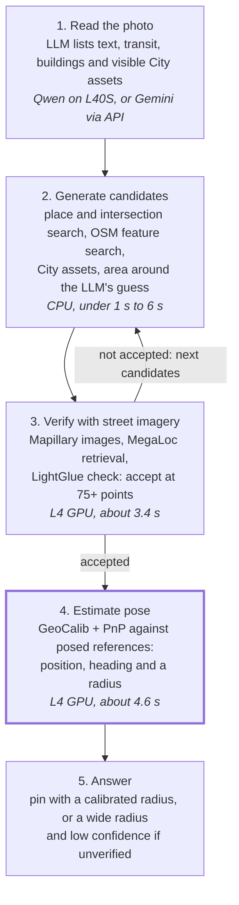

# GeoIssue geolocation: findings so far

As of 2026-10-17 · exported from the Claude doc [GeoIssue geolocation: findings so far](https://claude.ai/code/artifact/a0613494-17cc-454d-a524-52bb089403f8)

The image path works: the UTSC test photo was placed **5.04 m** from its true camera position in about 8 seconds, using Mapillary street imagery, image matching and pose estimation. Language models alone don't get close. On photo 2, the best of four model answers was 391 m off and the worst 13 km. Photo 2 also showed two limits: the true spot was outside the search area, and a construction site that postdates the reference imagery blocked the match. The newest photo (photo 3) is not placed yet; the first Qwen3.8-27B agent run on Modal ended without an answer when its context filled up.

| Photo | Method | Result | Time |
| --- | --- | --- | --- |
| 1: UTSC entrance (Street View) | Research agent by hand: web search, Wikimedia Commons, OpenStreetMap | About 5 m; location confirmed by the user | 1 h 45 min |
| 1: UTSC entrance | Automatic: image matching + pose estimation | **5.04 m**, heading 2.9° off, radius 12.2 m covers the truth | About 8 s |
| 2: Bathurst & Dundas (Street View) | Gemini 3.8 Flash, run 1 | 391 m off (Wolseley Loop) | 104 s |
| 2 | Gemini 3.8 Flash, run 2 | 13.0 km off (Long Branch Loop) | 129 s |
| 2 | Qwen3-VL 4B / 8B on the laptop | 1.7 km / 2.2 km off; the 8B named an intersection that doesn't exist | 102 s / 235 s |
| 2 | Map search + image matching | Not found: the true spot was 704 m outside all 56 candidate areas; even with 414 reference images at the spot, the best match had 26 verified points (75 needed) | 5.6 s + 8.5 s |
| 3: parking garage (phone photo) | Qwen3-VL 4B agent with tools, laptop | No answer: the model looped in its own reasoning | 20 min |
| 3 | Qwen3.8-27B agent with tools, Modal | No answer after 15 min: 21 turns, 48 tool calls; the 32k context filled and the model server errored. Best lead 40 verified points, not accepted. Run 2 with fixes: answered in 7.6 min (Sunnybrook Park area, 25 m radius claimed) on weak evidence, 13 verified points; not yet scored | 15 min / 7.6 min |

## Goal and constraints

GeoIssue must place a public social-media photo of a civic issue in Toronto to **within 10 m**, fast enough to run on every post.

- **Hybrid, not purely agentic.** An LLM (Claude, Gemini or an open model such as Qwen or GLM) reads the photo and steers. Deterministic tools and identification data generate and verify the location.
- **Toronto only.** Every tool can assume the photo is inside the city, which turns a planet-scale search into a city-scale one.
- **Speed.** The first by-hand test took 1 h 45 min. The target is seconds per photo, which means local indexes instead of live web lookups.
- **Cost caps.** $10 for Vultr testing, enforced in code because Vultr has no user-set cap. Gemini is on a free tier with tight limits, so calls are used sparingly. Modal has a native workspace budget.
- **Licences.** Prefer permissive models (MegaLoc, ALIKED, LightGlue, GeoCalib) over non-commercial ones (SuperPoint, MASt3R, OrienterNet weights, UniDepth). Don't build on Google Street View imagery in code.

## Research findings

Nothing that guesses a location from the image alone reaches 10 m. Metre-level answers come from geometry: matching against street imagery whose positions are known, or snapping to surveyed City assets. Six research threads covered prior art, LLM benchmarks, commercial tools, Toronto data, metre-level localization, and a live case study. The full report is in this folder: `LLM image geolocation for Toronto.md`.

| Finding | Evidence | What it means for GeoIssue |
| --- | --- | --- |
| Global geolocators stop at about 1 km | [GeoCLIP](https://arxiv.org/html/2309.16020): 14% within 1 km on Im2GPS3k, trained with 150 m GPS noise. The best published systems reach about 20–33% within 1 km | GeoCLIP is at most a cheap coarse prior; its [GPS gallery](https://github.com/VicenteVivan/geo-clip) can be swapped for a Toronto grid |
| Picarta's headline is vendor-only | Claims 44.8% within 1 km ([Picarta V2](https://picarta.ai/picarta-v2)); its API is Enterprise-only ([Picarta API](https://picarta.ai/api)) | Copy its interface (hard area constraint plus a text hint, ranked candidates), not its numbers |
| Metre-level products rest on dense street imagery | GeoSpy/Raven claims "down to the meter" from dense city imagery; police users called its output "a clue" ([GIGAZINE on 404 Media](https://gigazine.net/gsc_news/en/20260213-cops-buying-geospy-ai-geolocates-photos)) | Supports matching against street-level imagery |
| LLMs alone are far coarser than 10 m | The finest LLM benchmark threshold is 500 m ([Thinking with Map](https://arxiv.org/html/2601.05432)). On text-rich social photos, GPT-4.1 and Claude 3.7 placed about 60% within 1 km ([arXiv 2508.19967](https://arxiv.org/html/2508.19967v1)) | LLMs read clues and steer; they don't set the pin |
| LLMs confirm wrong places confidently | 83.8% of false confirmations carried confidence of 0.8 or more ([GeoContext](https://arxiv.org/abs/2609.05761)); Bellingcat found every model hallucinated ([Bellingcat 2025](https://www.bellingcat.com/resources/how-tos/2025/06/06/have-llms-finally-mastered-geolocation/)) | Never let the LLM verify; use geometric checks |
| Map tools are the tools that matter for LLMs | Adding a map/place tool raised accuracy within 500 m from 1.1% to 16.2% ([Thinking with Map](https://arxiv.org/html/2601.05432)) | Give the LLM place search and map-feature search |
| Pose estimation is sub-metre when matching works | About 90% of Aachen queries within 0.25 m ([hloc](https://github.com/cvg/Hierarchical-Localization)) | The 10 m budget goes on reference accuracy and camera-to-object distance, not the localizer |
| Google Street View can't be used in code | Its terms bar deriving content from Street View and using it to test models ([Maps Platform terms](https://cloud.google.com/maps-platform/terms)) | Mapillary for automated matching; Street View only as a human link-out |
| Toronto publishes surveyed assets | 305,237 poles digitized to ±30 cm ([City poles CSV](https://ckan0.cf.opendata.inter.prod-toronto.ca/dataset/cdf46145-7a91-4f1c-9dd1-91cd58338238/resource/5ce5f150-f0be-4417-af94-d531594d61f4/download/poles-4326.csv)), plus shelters, hydrants and bike rings with IDs | Absolute anchors that global products lack |
| Feature co-occurrence search narrows fast | [Bellingcat's OSM search](https://bellingcat.com/resources/how-tos/2023/05/08/finding-geolocation-leads-with-bellingcats-openstreetmap-search-tool) finds places where chosen features sit near each other | Rebuilt locally; runs citywide in 5.6 s |

## Pipeline at a glance

The LLM reads the photo and proposes where to look. Map, asset and image tools generate and verify candidates. Pose estimation sets the pin and its radius. If no candidate passes the 75-point check, the agent loops back for new candidates, or answers with a wide radius and low confidence.

## What was tested

Twenty-odd tests across models, tools and cloud setups. Every number below comes from a script run; the logs are under `research/geoloc_tests/results/`.

**Models and agents**

| Test | Setup | Result |
| --- | --- | --- |
| Gemini 3.8 Flash, photo 2, two runs | One call each; photo plus a JSON prompt | Read the scene well, including a phone number on a sign. Picked a different loop each run: 391 m and 13.0 km off, both at 95%+ confidence. 104–129 s, about 90% of it hidden thinking |
| Gemini 4 Argon | One call | Blocked: free-tier quota for Argon is zero (HTTP 429) |
| Qwen3-VL 8B, laptop, photo 2 | Thinking off / on | Off: hit the output cap without answering (297 s). On: "St. Clair & Eglinton", which don't intersect; 2.2 km off (235 s). 26% of the model spilled onto the CPU |
| Qwen3-VL 4B, laptop, photo 2 | Thinking on | "Yonge & Queen", 1.7 km off (102 s). Its list of visible objects was good |
| Agent harness, 4B, photo 2 | Tools, 6 min | Plumbing worked: place search for "Impact", then Mapillary harvest and matching on 146 images in 41.6 s, correctly rejected at 41 verified points |
| Agent harness, 4B, photo 3 | Tools, 20 min, two runs | Run 1: no output cap, so its first turn thought for 26 min. Run 2: one tool call on a misread word ("SHE"), then four turns of thinking with no tool call |
| Agent harness, Qwen3.8-27B on Modal, photo 3 | Tools, 20 min, L40S + L4 | GPU confirmed (L40S, 20.6 GB in use). About 20 of its calls pasted coordinates into the place search, which can't search by location, so the context hit 32,215 of 32,768 tokens and the model server returned HTTP 500. Three image checks (403, 940, 1,767 references) peaked at 40 verified points. Run 2, after adding a nearby-places tool, repeat blocking and history shrinking: 17 turns and 36 calls, context under 14k tokens, answer in 7.6 min. It answered the Sunnybrook Park area with a 25 m radius although Mapillary had only 3–4 images there and the best match had 13 verified points: overconfident |

**Tools and infrastructure**

| Test | Result |
| --- | --- |
| Local OSM search: streetcar track within 40 m of a large surface lot | 56 candidate areas citywide in 5.6 s. The public Overpass servers all failed (timeout, 504, 500) |
| Mapillary harvest around the 56 areas | 5,375 images in 10.6 min; one area had none, five had fewer than 25 |
| Image matching, 40 held-out Mapillary photos | Panorama-only pool: top-1 within 25 m rose from 37.5% to 82.5% after proper panorama reprojection. 3.4 s per photo |
| Pose estimation, 36 held-out Mapillary photos | Dense coverage: median 4.3 m, 76% within 10 m. Sparse: 7.8 m, 69%. The uncertainty radius covered the truth about 90% of the time. 4.6 s per photo |
| Photo 1 end to end (matching + pose) | **5.04 m** from the confirmed camera position |
| Photo 2 with 414 reference images at the true spot | Failed: best 26 verified points (75 needed); the construction site isn't in the older imagery |
| Asset-pattern matcher, 30 synthetic views | Citywide: true spot never ranked first. Within 200 m: a 3-object pattern matches a median of 2 places |
| Vultr CPU smoke tests | Create → run → destroy in 89 s for $0.007. The on-server self-destroy was blocked by the API key's IP allowlist |
| Vultr GH200 | Refused: "open a support request for access to this product" |
| Modal model pull | Qwen3.8-27B (17 GB) cached in Modal storage in 499 s on a CPU container |

## Tools built

Fifteen scripts in `research/geoloc_tests/`, all runnable on the laptop and on Modal. Map and asset searches run in under a second against local copies of the data. Image matching and pose estimation take a few seconds each on a GPU.

| Tool | What it does | Compute | Speed |
| --- | --- | --- | --- |
| `places.py` | Fuzzy search over 197,905 named places, plus street-intersection lookup | CPU | Milliseconds; 3 s to build |
| `osm_local_search.py` | Bellingcat-style search: every place where map feature B lies within N m of feature A | CPU | 5.6 s citywide |
| `assets_load.py`, `asset_search.py` | City asset layers in DuckDB (305k poles, 43k hydrants, 17k bike rings, 10k bins, 9.4k TTC stops, 5.8k shelters, 3.4k signals, 2.3k benches) and co-occurrence search | CPU | 0.45 s per query |
| `asset_pattern.py` | Finds camera poses whose visible City assets match an object list in left-to-right order | CPU | 4–50 s |
| `mapillary_harvest.py` | Downloads Mapillary reference images around candidate points, with 2048 px panoramas | Network | About 15–45 s per point |
| `pano.py` | Reprojects 360° panoramas into level 90° camera views with known headings | CPU | Milliseconds per view |
| `match.py` | MegaLoc retrieval plus ALIKED + LightGlue verification; accepts a match at 75+ verified points | GPU | 3.4 s per photo once the index is built |
| `pose.py` | GeoCalib focal length and tilt, re-aligned reference poses, triangulation, PnP, uncertainty radius | GPU | 4.6 s per photo |
| `model_test.py` | Runs any vision model on a photo with a fixed prompt, logging answer, thinking and timing | Model-dependent | — |
| `geoloc_agent.py` | The agent: a vision LLM calls the tools above against a time budget, logging every turn | Model-dependent | Budgeted, e.g. 20 min |
| `modal_app.py` | The same agent on Modal: CPU tools, L4 for matching and pose, L40S for the LLM | Mixed | Per-second billing |
| `cloud/` (`gpu_run.py`, `reaper.sh`, `vultr_guard.py`) | Vultr runs that end in a destroy, with dynamic shutdown and a $10 cap | — | 87 s to a ready CPU server |

- **Data:** a local Toronto OpenStreetMap extract (102 MB) and DuckDB databases for assets (122 MB) and places (17 MB).
- **Licences:** MegaLoc, ALIKED, LightGlue and GeoCalib allow commercial use. Several City asset layers list no licence in the catalogue.

## Compute and cost

Modal is now the main GPU platform: it bills per second, scales to zero on its own and has a native budget cap. The laptop runs everything except large models. Vultr works for CPU servers, but its GPUs need a support ticket. Total spend so far is about **$0.02 on Vultr** plus Modal usage, which runs on the free monthly credit.

| Platform | Billing | Shutdown | Spending cap | Status |
| --- | --- | --- | --- | --- |
| Laptop (RTX 4060, 8 GB) | Free | — | — | Runs matching, pose, indexing and models up to 4B. The 8B spills onto the CPU; 27B doesn't fit. Ollama was once stopped for low memory |
| Vultr | Hourly, 1-hour minimum per server; stopped servers still bill | Our own: the run controller destroys in `finally`; an on-server dead-man switch and a laptop guard destroy on done, idle, unreachable or budget, with no fixed timer | None in Vultr; enforced in code at $10. Account holds a $100 credit | CPU servers work. GPU (L40S, GH200 at $1.99/h) needs a support ticket. The API key's IP allowlist blocks on-server self-destroy |
| Modal | Per second | Built in: containers stop after 5 min idle | Native workspace budget (Usage & Billing); $30/month Starter credit | Working: model cached; first GPU run done (L40S, about 15 min, roughly $0.85 estimated) |

Modal GPU prices from third-party trackers: L4 about $0.80/h, L40S about $1.95/h, A100 80 GB about $2.50/h, H100 about $3.95/h, B200 about $6.25/h ([Spheron](https://www.spheron.network/blog/modal-gpu-pricing-2026-per-second-billing/)). Pinning a region or requiring non-preemptible machines raises these.

One agent run on Modal (20 min of L40S plus a few minutes of L4) should cost roughly $0.80–1.00.

## What failed and why

Most failures came from candidate generation and from scenes that have changed, not from the matching or pose maths.

| Failure | Cause | Lesson |
| --- | --- | --- |
| Gemini named loops 15 km apart, each at 95%+ confidence | It picks a place from memory; its confidence doesn't track accuracy | The LLM proposes; geometry decides |
| Photo 2's true spot wasn't among the 56 candidates | The lot across the street isn't tagged as a large surface lot within 40 m of the track in OpenStreetMap | Generate candidates from several independent searches. Gemini run 1 was only 391 m off, so a 500 m image search around the LLM's guess would have covered it |
| Photo 2 failed even with 414 reference images at the spot | A construction trailer and fencing dominate the photo and postdate the Mapillary imagery | Match on permanent structure, prefer recent references, and fall back to map geometry and assets when the scene has changed |
| Asset patterns didn't pin places citywide | Street lights and hydrants are everywhere; one view shows only 1–2 assets | Use asset patterns only after narrowing to a few hundred metres, and weight rare assets (shelters, streetcar stops, crossovers) |
| Small local models looped or invented answers | 4B and 8B models reason in circles under tool use and hit output caps | Cap tokens and time per turn, retry without thinking, and use at least a 27B model to drive the agent |
| Public OpenStreetMap servers failed repeatedly | Overpass servers were at capacity in both tests | Keep local copies of the map data |
| The by-hand UTSC test wasted 35 min | It ruled out UTSC after checking only two famous buildings | Search complete citywide layers, not hand-picked places |
| Vultr self-destroy and GPUs didn't work | The key's IP allowlist blocks the server; GPUs need a support ticket. Powering off as a fallback kept billing | Destroy is the only off switch; keep a laptop-side guard; prefer Modal for GPUs |
| A local run stalled for 27 min | Probably the laptop sleeping mid-request | Run long jobs in the cloud |

## Open decisions and next steps

The biggest open question is which model drives the agent: Qwen3.8-27B on Modal, or Gemini 3.8 Flash calling the same tools over an API.

**Gemini with hosted tools.** The CPU tools can run on a Vultr CPU server (no GPU ticket needed) or on Modal. Gemini then calls them through function calling. Gemini only chooses the tools; our server runs them.

- **Agent mode:** each agent turn is one Gemini call, typically 5–12 calls per photo; Gemini can request several tools in one turn.
- **Pipeline mode:** one call to read the photo and one to choose among the verified candidates, so 1–2 calls per photo.
- **Free tier:** limits would allow only a handful of photos a day in agent mode.
- **Cost:** most of each call's cost is hidden thinking, so capping the thinking budget is the main control.

**Decisions for the user**

- [ ] Where photo 3 was taken, so its runs can be scored
- [ ] Set a Modal workspace budget in Usage & Billing
- [ ] Link the Google Cloud credit to the Gemini project (unlocks Argon and more Flash calls)
- [ ] Open a Vultr support ticket for GPU access, or rely on Modal for GPUs
- [ ] Choose the agent's model: Qwen3.8-27B, Gemini 3.8 Flash, or both compared on the same photos

**Next steps**

1. Finish the Qwen3.8-27B run on photo 3, then run photo 2 against its known location.
2. Add a Gemini backend to the agent harness and compare it with Qwen on the same photos and tools.
3. Fix candidate generation: always search imagery within 500–1,000 m of the LLM's own guess, alongside the map searches.
4. Measure Mapillary coverage and recency across Toronto.
5. Build a labelled test set of 20–50 photos with known locations.
6. Add a job queue and billing-hour-aware shutdown for Vultr, if GPU access is granted.
