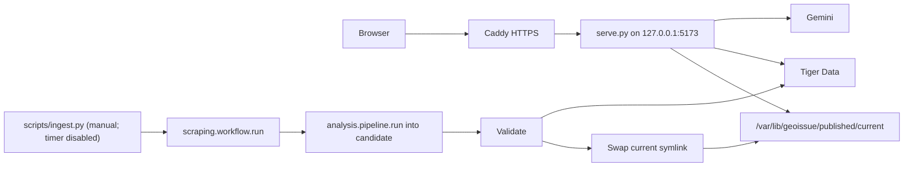

# Vultr implementation plan for GeoIssue

Created October 18, 2026; revised the same day. Status: planned; no cloud resources provisioned.

## Outcome and scope

Run the GeoIssue website, Python API, and an on-demand collection/analysis job on one Vultr Cloud Compute instance. Keep Gemini for photo analysis and Tiger Data for issue snapshots and report activity. The demo keeps working after the development laptop closes.

First release: hosting, a safe public file policy, and one bounded ingestion command that is run manually. A daily schedule ships as an installed-but-disabled systemd timer, so the team can turn it on later with one command. Evidence photos stay on the instance. Object Storage, shared submissions, and Vultr inference are follow-up work.

Use Ubuntu 24.04, Python 3.12, a virtual environment, Caddy for HTTPS, and systemd. Start with a small CPU instance (2 GB RAM, to validate with one real run). No GPU is needed: image models are called through Gemini. See [Cloud Compute provisioning](https://docs.vultr.com/products/compute/instances/cloud-compute/provisioning); confirm plan cost and credits first.



## 1. Public file policy and server changes (`scripts/serve.py`)

This step is required before the server is reachable from the internet. Today `serve.py` serves the whole repository except dot-files, which would expose `data/analyzed/issues.json`, `sightings.json` (full-precision locations), and raw `scraping/data/` batches.

- Replace repository-wide static serving with an allowlist applied to GET and HEAD:
  - `/`, `/index.html`, `/sw.js`
  - `/src/**/*.js`, `/src/**/*.css`
  - `/assets/evidence/*`
  - `/data/analyzed/issues.public.json`, `report.json`, `areas.json`, `photos/*`
  - Everything else returns 404, including directory listings, encoded traversal, and symlinks that resolve outside the allowed roots.
- When `GEOISSUE_PUBLISHED_DIR` is set, serve `/data/analyzed/*` from `$GEOISSUE_PUBLISHED_DIR/current/` instead of the repository. Unset keeps today's local behaviour.
- Add `GET /api/health` (process readiness only; no Gemini or database call).
- Extend `GET /api/status` with an `ingest` object read from `current/ingest-status.json`: last successful run time, status, issue count. No paths or errors that reveal configuration.
- Cap concurrent Gemini POSTs with a small semaphore (for example 4) and return 429 when full. Keep the existing 12 MB body limit. Per-client rate limiting is deferred.
- Keep binding to `127.0.0.1`; Caddy is the only public entry point.

Done when: allowed assets load through a local reverse proxy, every private path returns 404, and existing Gemini/Tiger fallbacks still work.

## 2. Ingestion wrapper (`scripts/ingest.py`)

Reuse [`scraping/workflow.py`](scraping/workflow.py), which already runs collect, deduplicate, screen, handoff and describe with caching and an ok/partial/failed status. Do not build another orchestrator.

Small supporting changes:

- `scraping/config/workflow-vultr.json`: Bluesky only, `{"name": "bluesky-live", "platform": "bluesky", "queries": "bluesky-queries.txt", "max_images": 20, "max_posts": 20}`.
- `scraping/workflow.py`: read an optional per-source `max_posts` (default stays 100).
- `analysis/pipeline.py`: add an optional `photo_url_prefix` to `run()`. When set, `_publish_photo` writes `evidence_thumbnail` as `prefix + "photos/<file>"` instead of a repository-relative or `file:` URL. Defaults are unchanged for local runs.

`ingest.py` steps:

1. Take an exclusive `flock` on `$GEOISSUE_PUBLISHED_DIR/ingest.lock`. While holding it, remove a stale `.workflow.lock` left by a killed run (the workflow's own lock is not cleaned up on SIGKILL).
2. Call `workflow.run(output=scraping/data/vultr-workflow, config_path=workflow-vultr.json, max_screen_requests=20, max_description_requests=20, exploration_images=0)`. Budgets are CLI flags so the first manual run can use larger ones.
3. Stop without publishing unless the workflow status is `ok`. Caches are kept for the next attempt.
4. Create `generations/<UTC timestamp>/`, copy the previous generation's `.summary_cache.json` into it, and call `analysis.pipeline.run(handoff/post-groups.jsonl, config, out_dir=candidate, photo_url_prefix="./data/analyzed/")`.
5. Validate the candidate:
   - Zero issues is refused when the previous generation had issues, unless `--allow-empty` is passed. This prevents a failed collection from wiping Tiger Data, because `tiger.sync()` replaces the whole dataset.
   - Every `evidence_thumbnail` is an `https://` URL or `./data/analyzed/photos/<file>` that exists in the candidate.
6. If `TIGER_DATABASE_URL` is set, call `tiger.sync(result["public"], result["events"], result["report"], result["areas"])`. On failure, delete the candidate and keep the current generation.
7. Write `ingest-status.json` into the candidate, then atomically repoint `current` to it (create a temporary symlink and `os.replace` it). If this fails after the database commit, report it; rerunning `ingest.py --republish <generation>` repeats only the swap.
8. Keep the newest three generations and delete older ones.

Photos are named by issue ID, so a page that loads during the few seconds between database commit and swap may briefly miss a new photo. This is acceptable for the demo.

Done when: a manual run updates files, photos, and Tiger Data; repeating it does not duplicate sightings; a forced failure leaves the previous site intact.

## 3. Deployment package (`deploy/`)

- `deploy/Caddyfile`: `{$GEOISSUE_DOMAIN} { reverse_proxy 127.0.0.1:5173 }`.
- `deploy/geoissue.service`: dedicated `geoissue` user, `WorkingDirectory=/opt/geoissue`, `EnvironmentFile=/etc/geoissue/env`, `ExecStart=/opt/geoissue/.venv/bin/python scripts/serve.py`, `Restart=on-failure`, enabled at boot.
- `deploy/geoissue-ingest.service`: `Type=oneshot`, same user, environment and directory, `ExecStart=.../python scripts/ingest.py`, `TimeoutStartSec=45min`.
- `deploy/geoissue-ingest.timer`: `OnCalendar=daily`, `Persistent=false`, `RandomizedDelaySec=15min`. Installed but **not enabled**. systemd does not start a oneshot that is still running, and `ingest.py` holds a lock, so runs never overlap.
- `deploy/README.md`: instance setup, dependencies (`scraping/requirements.txt`, `analysis/requirements-tiger.txt`), environment file, DNS, service install, updates, logs, rollback, teardown, and the timer commands:

```sh
sudo systemctl start geoissue-ingest.service        # one manual run
sudo systemctl enable --now geoissue-ingest.timer   # turn on the daily run
sudo systemctl disable --now geoissue-ingest.timer  # turn it off again
```

The environment file `/etc/geoissue/env` holds `GEMINI_API_KEY`, `TIGER_DATABASE_URL`, `GEOISSUE_PUBLISHED_DIR=/var/lib/geoissue/published`, and `GEOISSUE_DOMAIN`. Both services read it; both existing key loaders check environment variables first. It is never committed.

Because published output lives outside the Git working tree, `git pull` on the server never conflicts with ingested data. Updates: stop any running ingest, `git pull`, run checks, restart `geoissue.service`.

Update [`scraping/docs/AUTOMATION.md`](scraping/docs/AUTOMATION.md) to note that the Vultr daily timer exists and is disabled, consistent with its current "no daily job is enabled" policy.

Done when: setup is repeatable from a clean Ubuntu instance and a reboot restores the site without a developer terminal.

## 4. Provision and launch

Inputs: Vultr account with credits, an SSH public key, a domain or subdomain with DNS access, `GEMINI_API_KEY`, and `TIGER_DATABASE_URL`. Secrets go in server configuration only.

1. Create one Ubuntu VM in a region near the audience and database. Allow SSH from the team only and HTTP/HTTPS publicly; port 5173 stays local.
2. Install the runtime and app, write the environment file, and run `python -m analysis.tiger init` only if the target database has no schema.
3. Seed `published/generations/initial/` from the committed `data/analyzed/` public files and photos, and point `current` at it. Label it as a snapshot until a cloud run succeeds.
4. Optionally copy local screening and description caches (`scraping/data/**/screening.jsonl`, `scraping/data/issue-details-cache.jsonl`) so the first server run does not re-pay for known images.
5. Point DNS, install the Caddyfile, verify HTTPS.
6. Run one manual ingest with larger budgets (for example `--max-screen-requests 150 --max-description-requests 60`), then verify the published files and Tiger Data counts.
7. Leave the timer disabled. Record the URL, deployed commit, and last successful run in `deploy/README.md`.

## 5. Verification

New focused tests (no paid API calls; saved inputs and stand-ins):

- Server: allowlisted assets return 200 for GET and HEAD; `issues.json`, `sightings.json`, `scraping/data/...`, `.env`, encoded traversal, and symlink escapes return 404; `/api/health` makes no upstream call; the Gemini semaphore returns 429 when full.
- Ingest: a partial workflow does not publish; an empty result after a non-empty generation is refused; a Tiger failure keeps the current generation; a successful run swaps `current` and is idempotent when repeated.

Existing checks:

```sh
npm test
npm run check
python3 -m unittest discover -s analysis/tests -t .
python3 -m unittest scraping.tests.test_bluesky scraping.tests.test_screen scraping.tests.test_handoff scraping.tests.test_describe
```

Any database integration test uses a disposable `TIGER_TEST_DATABASE_URL`, never the team database.

Demo acceptance: open the HTTPS URL on another device, show the dataset and its last successful run time, trigger one manual ingest, and show the matching evidence and Tiger Data activity. If nothing new is found, show the honest unchanged run. Use the separately labelled replay dataset only when a predictable surge is needed.

Recovery: repoint `current` to the previous generation and, if needed, rerun `tiger.sync` from that generation's files.

## 6. Deferred

- Enabling the daily timer (one command; needs team agreement and a Gemini quota check).
- Dashboard widget for ingestion status (the data is already in `/api/status`).
- Per-client rate limiting and trusted-proxy address handling.
- [Object Storage](https://docs.vultr.com/products/storage/object-storage/provisioning) for evidence photos, keeping the issue contract's URL fields.
- Shared submissions endpoint replacing the browser-local stub in `src/data.js`.
- Optional ward summaries via [Vultr Serverless Inference](https://api.vultrinference.com/docs/get-started/quickstart), keeping the template fallback.
